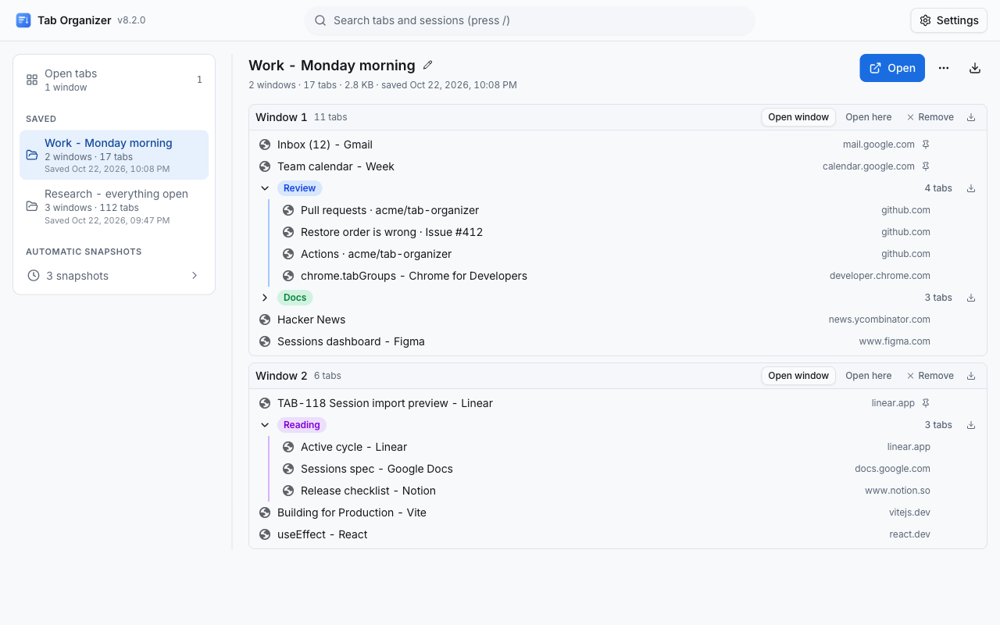
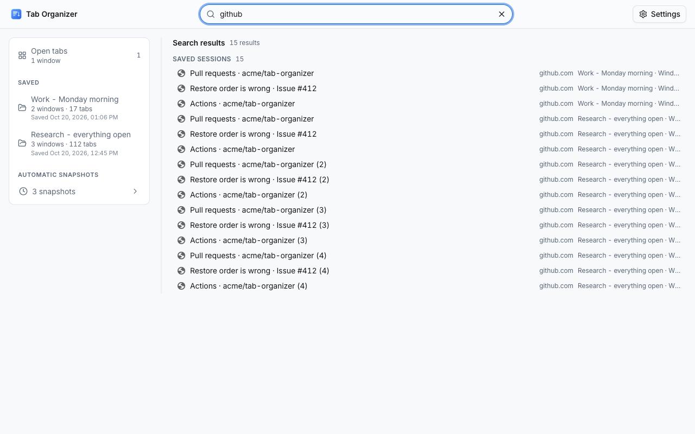
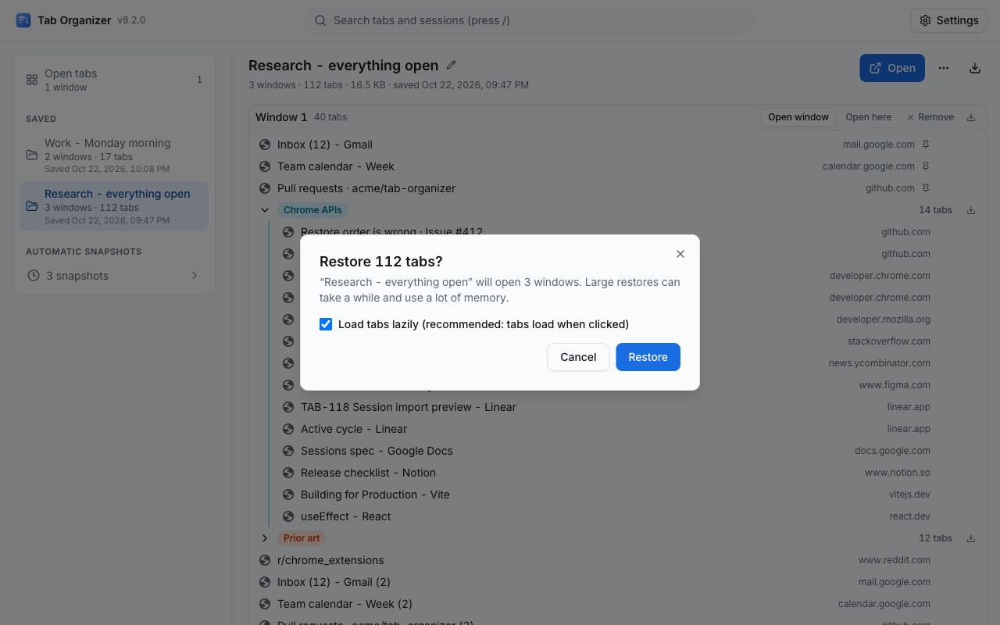
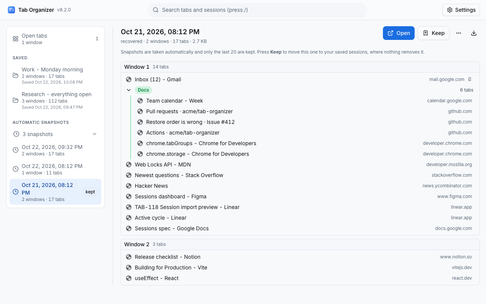
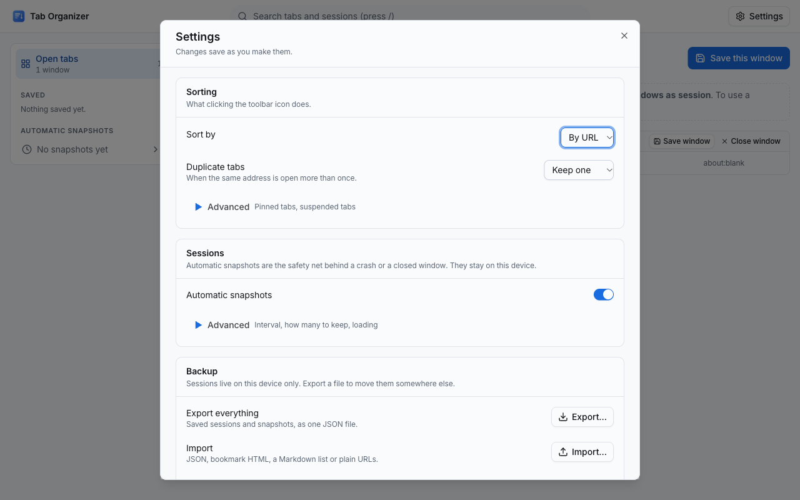
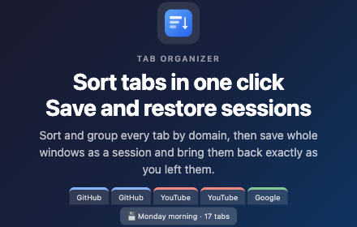
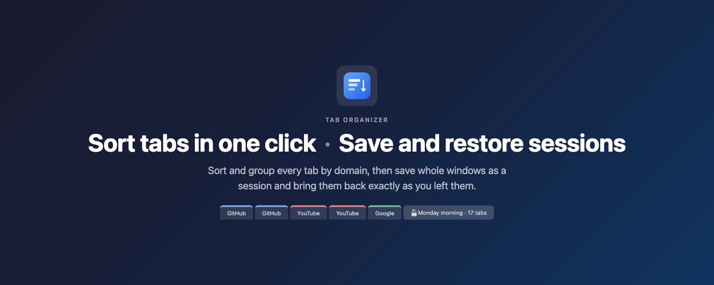
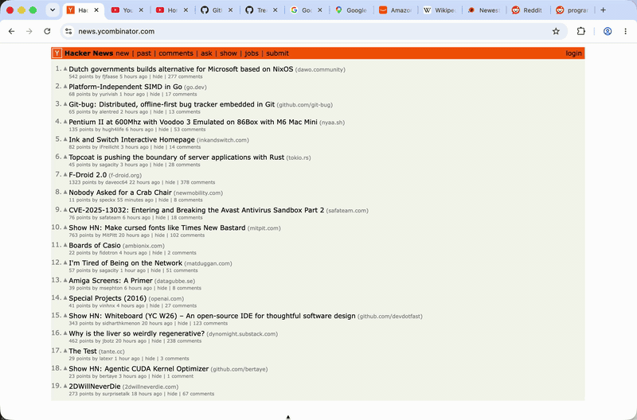

# Tab Organizer: Chrome Web Store Listing

> **This file is the single source of truth for the [Chrome Web Store listing](https://chromewebstore.google.com/detail/tab-organizer/bmbpmnfhfbdjdjpblimidmbohgccmjdg).**
> Everything shown on the store page (text, images, video, privacy disclosures) is kept here so the store and GitHub never drift apart.
> The store's Description field only accepts plain text, so the [Description](#description) below is kept as plain text inside a code block: what is in the block is what gets pasted. Nothing is generated from this file.
> The listing is localized: English is the default, and [Localized listings](#localized-listings) holds the Korean, Spanish and Japanese Summary and Description.

## Store listing

### Product details

| Field       | Value                                                       | Where it comes from                                                                                                                |
| ----------- | ----------------------------------------------------------- | ---------------------------------------------------------------------------------------------------------------------------------- |
| Title       | Tab Organizer                                               | `extName` in `public/_locales/<lang>/messages.json` → manifest `name` (`__MSG_extName__`)                                          |
| Summary     | See [Summary](#summary)                                     | `extDescription` in `public/_locales/<lang>/messages.json` → manifest `description` (`__MSG_extDescription__`, max 132 characters) |
| Category    | Extensions › Functionality & UI                             | Developer Dashboard                                                                                                                |
| Language    | English (default), Korean (ko), Spanish (es), Japanese (ja) | The folders of `public/_locales/`; the manifest's `default_locale` is `en`                                                         |
| Description | See below                                                   | The code block under [Description](#description), and one per language under [Localized listings](#localized-listings)             |

The store reads the Title and Summary of every language out of the uploaded package (the manifest's `__MSG_extName__` / `__MSG_extDescription__` resolved through that language's `messages.json`), so they cannot be typed into the dashboard: change them in `public/_locales/`. The Summary blocks in this file are copies kept for review, and `pnpm test` fails when one differs from its `extDescription` or exceeds 132 characters. `package.json` `description` stays equal to the English one.

### Summary

```text
Sort and group every tab in one click, then save and restore whole windows as sessions. Offline, no account, stays on your device.
```

### Description

Kept to at most 500 characters (set by the owner): the first lines and the screenshots decide an install, and the details live on the website and in the README. Permission justifications are not part of it; they go in the [Privacy](#privacy) answers and may be as detailed as needed.

Paste the block below into the store's **Description** field as it is. The field takes plain text only, so there is no Markdown in it. On GitHub the copy button at the block's top-right corner takes the whole text.

```text
One click on the icon sorts every tab in the window by site, title or URL, groups them and clears duplicates.

• Save windows as sessions and restore them later, with tab groups and pinned tabs
• Automatic snapshots bring your tabs back after a crash
• Assemble! pulls every window into one
• Search, import and export your sessions

No account, no tracking: everything stays on your device.

Guide and FAQ: https://thilllon.github.io/tab-organizer/support/
```

### Graphic assets

The Settings and dashboard screenshots and the promo tiles are generated by `pnpm release` (`scripts/prepare-registration.ts`) into `assets/`. Upload them in the order listed. Each step of that script can be skipped on its own with `SKIP_BUILD`, `SKIP_OPTIONS`, `SKIP_DASHBOARD` or `SKIP_PROMO`, so one asset can be regenerated without redoing the rest. `before-sort.png`, `after-sort.png`, `demo.mp4` and `demo.gif` are kept as committed and no longer regenerated.

Per-language screenshots: `LOCALES=en,ko,es,ja pnpm exec tsx scripts/prepare-registration.ts` shoots the Settings and dashboard screenshots once per UI language (Chromium started with `--lang=<code>` and the matching `LANGUAGE`/`LANG`, fixture session names in that language). English keeps the file names below in `assets/`; every other language writes the same names to `assets/<code>/`. Without `LOCALES` only English is shot. `pnpm store:bundle` copies whatever exists into `release/store-<version>/screenshots/<code>/` and lists it per language in `SUBMIT.md`.

#### Store icon (128 × 128)

`public/img/logo-128.png`: also used as the manifest icon.


#### Screenshots (1280 × 800, up to 5)

1. `assets/dashboard-sessions.png`: the Sessions dashboard: open windows pane, saved sessions with an expanded window → group → tab tree, history section

   

2. `assets/dashboard-search.png`: unified search across open tabs, saved sessions and history

   

3. `assets/dashboard-restore.png`: a large restore in progress with the progress indicator and Cancel button

   

4. `assets/dashboard-history.png`: the snapshots section with the recovered entry

   

5. `assets/screenshot-1280x800.png`: the Settings dialog

   

`scripts/prepare-registration.ts` captures four dashboard screenshots; `assets/dashboard-history.png` is kept as an alternate. `assets/before-sort.png` / `assets/after-sort.png` are kept as committed (README and website).

#### Small promo tile (440 × 280)

`assets/promo-small-440x280.png`: regenerated by `pnpm release` with the v7 tagline "Sort tabs in one click · Save and restore sessions".



#### Marquee promo tile (1400 × 560)

`assets/promo-marquee-1400x560.png`: regenerated together with the small tile.



#### Promo video

The store only accepts a **YouTube URL** for the promo video; none is published yet. A demo recording (frozen) lives in the repo:

- `assets/demo.mp4`: [download / play](assets/demo.mp4)
- `assets/demo.gif`: GIF of the same recording (kept as committed, no longer regenerated)



### Additional fields

| Field          | Value                                             |
| -------------- | ------------------------------------------------- |
| Homepage URL   | https://thilllon.github.io/tab-organizer/         |
| Support URL    | https://thilllon.github.io/tab-organizer/support/ |
| Mature content | No                                                |

## Localized listings

The listing is localized through `public/_locales/`. Chrome picks the extension's own language from the browser's UI language (English, the manifest's `default_locale`, for anything else), and the Chrome Web Store does the same for the listing:

- **Title and Summary** of each language come from the uploaded package: the manifest's `__MSG_extName__` and `__MSG_extDescription__` resolved through `public/_locales/<lang>/messages.json`. The dashboard shows them read-only, so they are changed only there. The Summary blocks below are copies kept for review; `pnpm test` checks that each equals its `extDescription` and fits in 132 characters.
- **Description, screenshots, promo tiles and video** are typed or uploaded per language. In the [Developer Dashboard](https://chrome.google.com/webstore/devconsole), the Store listing tab has a language menu listing every locale in the package; pick one, paste its Description block from this file, upload its screenshots (`assets/<lang>/` when they exist), and save. A language left without its own Description or images shows the English (default) ones.
- Each block below is plain text pasted as it is, like the English one: no Markdown, `•` bullets, Chrome's own terms in that language, at most 500 characters (`pnpm test` checks every language) and linking that language's support page. Quoted menu items and buttons use the wording of that language's `messages.json`; when a translation there changes, change the quote here too.
- The promo tiles carry English text and are shared by every language.

### Summary (ko)

Korean. Read from `public/_locales/ko/messages.json` (`extDescription`); shown here for review only.

```text
클릭 한 번으로 모든 탭을 정렬하고 그룹으로 묶은 뒤, 창 전체를 세션으로 저장하고 복원합니다. 오프라인, 계정 불필요, 데이터는 기기에만 저장됩니다.
```

### Description (ko)

Korean. Paste into **Description** with the dashboard's language set to Korean.

```text
아이콘을 한 번 누르면 창의 모든 탭이 사이트, 제목, URL 순으로 정렬되고 그룹으로 묶이며 중복 탭이 정리됩니다.

• 창을 세션으로 저장했다가 탭 그룹, 고정 탭까지 그대로 복원
• 자동 스냅샷으로 브라우저가 꺼져도 탭 복구
• 모두 모으기로 여러 창을 한 창에
• 세션 검색, 가져오기, 내보내기

계정도 추적도 없습니다. 모든 데이터는 이 기기에만 저장됩니다.

사용법과 FAQ: https://thilllon.github.io/tab-organizer/ko/support/
```

### Summary (es)

Spanish. Read from `public/_locales/es/messages.json` (`extDescription`); shown here for review only.

```text
Ordena y agrupa todas las pestañas en un clic; guarda y restaura ventanas enteras como sesiones. Sin conexión ni cuenta, todo local.
```

### Description (es)

Spanish. Paste into **Description** with the dashboard's language set to Spanish.

```text
Un clic en el icono ordena todas las pestañas de la ventana por sitio, título o URL, las agrupa y elimina los duplicados.

• Guarda ventanas como sesiones y restáuralas con sus grupos y pestañas fijadas
• Las instantáneas automáticas recuperan tus pestañas tras un fallo
• ¡Reunir! junta todas las ventanas en una
• Busca, importa y exporta sesiones

Sin cuenta ni rastreo: todo se queda en tu dispositivo.

Guía y preguntas frecuentes: https://thilllon.github.io/tab-organizer/es/support/
```

### Summary (ja)

Japanese. Read from `public/_locales/ja/messages.json` (`extDescription`); shown here for review only.

```text
ワンクリックですべてのタブを並べ替えてグループ化し、ウィンドウ全体をセッションとして保存・復元できます。オフライン、アカウント不要、データは端末内に保存。
```

### Description (ja)

Japanese. Paste into **Description** with the dashboard's language set to Japanese.

```text
アイコンをクリックするだけで、ウィンドウ内のすべてのタブをサイト、タイトル、URL 順に並べ替え、グループにまとめ、重複タブを整理します。

• ウィンドウをセッションとして保存し、タブグループや固定タブごと復元
• 自動スナップショットで、クラッシュ後もタブを復旧
• 集合！ですべてのウィンドウを 1 つに
• セッションの検索、インポート、エクスポート

アカウント不要、追跡なし。データはすべてこのデバイスに保存されます。

使い方と FAQ: https://thilllon.github.io/tab-organizer/ja/support/
```

## Privacy

### Single purpose

Organize browser tabs: sort and group the tabs of the current window (by URL, title or domain, optionally removing or grouping duplicates), and save, restore, search, import and export sets of windows and tabs as sessions, all stored locally on the device.

### Permission justifications

| Permission         | Justification                                                                                                                                                                                                                                                                                                                                                                                                                                                                      |
| ------------------ | ---------------------------------------------------------------------------------------------------------------------------------------------------------------------------------------------------------------------------------------------------------------------------------------------------------------------------------------------------------------------------------------------------------------------------------------------------------------------------------- |
| `tabs`             | Required to read tab URLs and titles for sorting, for saving sessions and for the dashboard's live list of open windows, and to create tabs when restoring. Uses `chrome.tabs.query()`/`chrome.windows.getAll()` to read, `chrome.tabs.move()` to reorder and `chrome.tabs.create()`/`chrome.tabs.discard()` to restore. Tab data is stored only in local extension storage on the device when the user saves a session or while automatic snapshots run; it is never transmitted. |
| `tabGroups`        | Required to sort existing tab groups by title, to group duplicate tabs when the user enables that option, and to recreate a session's tab groups (title, color, collapsed state) on restore. Uses `chrome.tabGroups.query()`, `move()` and `update()`.                                                                                                                                                                                                                             |
| `storage`          | Required to persist user preferences (sort method, grouping mode, duplicate handling) via `chrome.storage.sync`, and to store saved sessions, automatic snapshots and session settings (tab URLs, titles, pinned state, group names/colors and window layout) via `chrome.storage.local` on this device only. Session data is never synced or transmitted; the user can delete any session, or all session data, from the dashboard.                                               |
| `contextMenus`     | Adds "Assemble!" (gather every window's tabs into the current one) and "Save all windows as session" to the extension icon's right-click menu (`contexts: ['action']` only; no menu items are added to web pages).                                                                                                                                                                                                                                                                 |
| `unlimitedStorage` | Lets saved sessions and snapshots exceed the default 10 MB `chrome.storage.local` quota for users with thousands of tabs. Data stays in local extension storage on the device; nothing is uploaded.                                                                                                                                                                                                                                                                                |
| `favicon`          | Displays site icons next to tabs in the dashboard by reading Chrome's local favicon cache through `chrome-extension://<id>/_favicon/`. No favicon is fetched from the network and no favicon data is stored.                                                                                                                                                                                                                                                                       |
| `alarms`           | A `chrome.alarms` timer that wakes the service worker on the user's chosen interval (any whole number of minutes from 1 to 1440; 5 by default) to take an automatic local snapshot of open windows for crash recovery. When the user turns snapshots off, no alarm exists. The worker still wakes briefly at browser start, on install or update, and when a setting changes, in every case to do local bookkeeping only.                                                          |

Host permissions: none. Content scripts: none. Remote code: not used. Minimum Chrome version: 123 (`minimum_chrome_version` in the manifest).

### Data usage

The extension does **not** collect or transmit any user data. When the user saves a session, or while automatic snapshots are enabled (the default), tab URLs, titles and window/group layout are written to `chrome.storage.local` on the user's device only; they are never sent anywhere, and the user can delete them at any time (per session, per snapshot, or all at once with "Delete all session data"). Export creates a file or clipboard text only when the user explicitly asks for it. All three certifications apply:

- Does not sell user data to third parties.
- Does not use or transfer user data for purposes unrelated to the item's core functionality.
- Does not use or transfer user data to determine creditworthiness or for lending purposes.

CWS privacy form, data types: tick **Web history** only, with the justification "URLs and titles of the user's open tabs are stored locally on the device when the user saves a session and by the automatic snapshot feature (on by default, can be turned off); nothing is transmitted off the device". Every other data type (personally identifiable information, health, financial, authentication, personal communications, location, user activity, website content) is **not** collected.

### Privacy policy URL

https://thilllon.github.io/tab-organizer/privacy/ (the full text is [PRIVACY_POLICY.md](PRIVACY_POLICY.md) in this repository)

## Distribution

| Field      | Value       |
| ---------- | ----------- |
| Visibility | Public      |
| Regions    | All regions |
| Pricing    | Free        |

## Updating the store listing

1. Edit this file. Every Description block (English under [Description](#description), the others under [Localized listings](#localized-listings)) is plain text and is pasted as it is, so write it in the store's conventions directly: a one-sentence hook, a few `•` lines, the privacy line and the support link; no Markdown and no em or en dash inside a block. Each Description must stay at most 500 characters (the owner's limit; the store itself allows 16,000) and each Summary under 132; `pnpm test` (`src/tests/store-listing.test.ts`) fails otherwise, and also when a Summary block differs from its locale's `extDescription`. Details that do not fit belong on the website (`site/src/i18n/copy-*.ts`) and in the README, not here. A change to the English text should reach the three translations in the same edit.
2. To change a Summary, edit `extDescription` in `public/_locales/<lang>/messages.json` (and `package.json` `description` for English), then the matching Summary block here. Commit. Nothing is generated; the pre-push hook and CI run the tests that check every limit.
3. Run `pnpm release` on `main` to regenerate the Settings, dashboard and promo images, bump the version, build and produce the ZIP in `release/`. Use `pnpm release --increment major` for a major relaunch such as v7.0.0, or `pnpm release --no-increment` when `package.json` already carries the version to publish. Per-language screenshots need `LOCALES=...` (see [Graphic assets](#graphic-assets)).
4. In the [Developer Dashboard](https://chrome.google.com/webstore/devconsole): upload the ZIP from `release/`, then for each language in the Store listing tab's language menu paste that language's Description block (GitHub's copy button on a block takes all of it; `release/store-<version>/SUBMIT.md` carries the same texts) and upload its screenshots, upload the promo tiles listed above, and copy the [Privacy](#privacy) answers, including the data-type rows of the privacy form, which must be re-reviewed whenever a permission or the snapshot default changes.
5. Submit for review.
