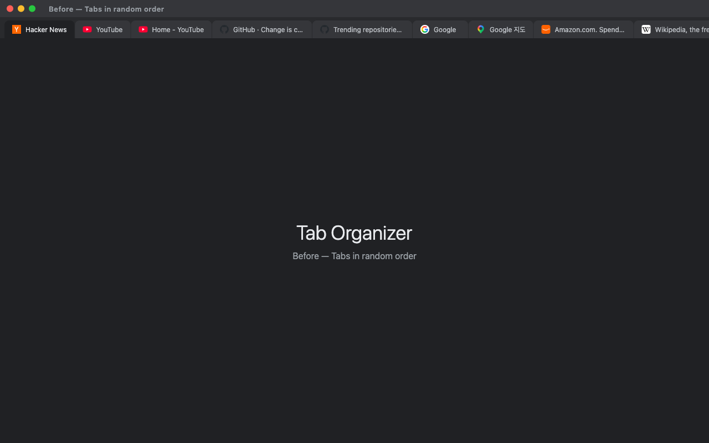
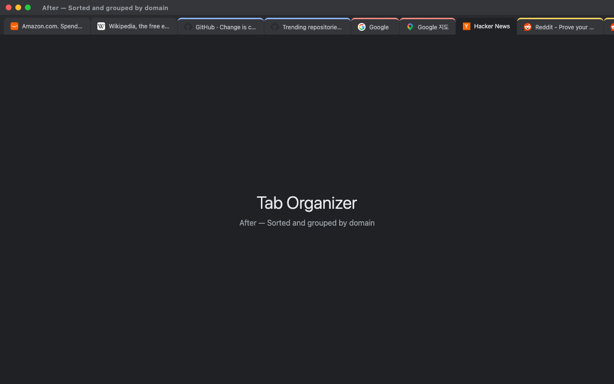
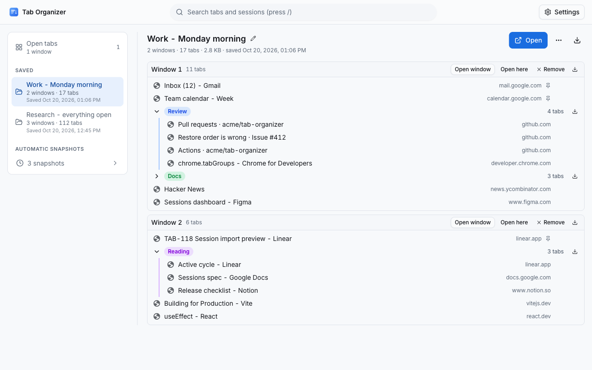
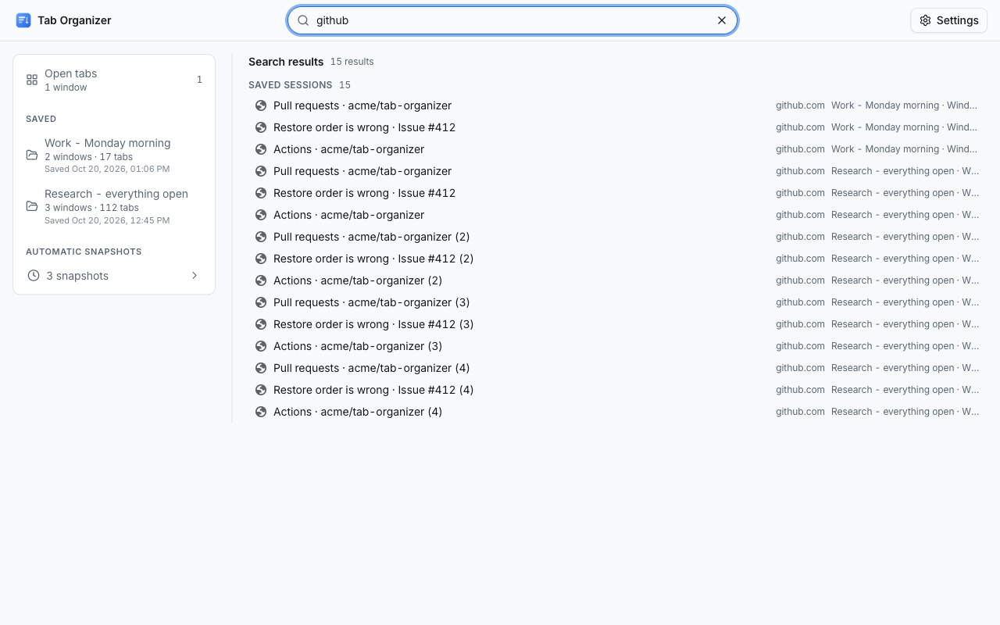
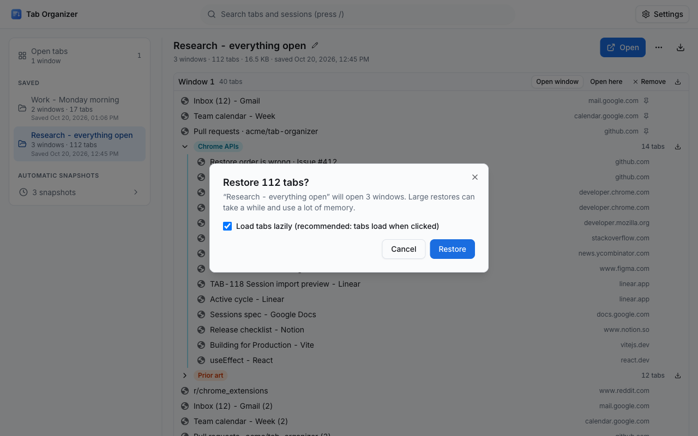
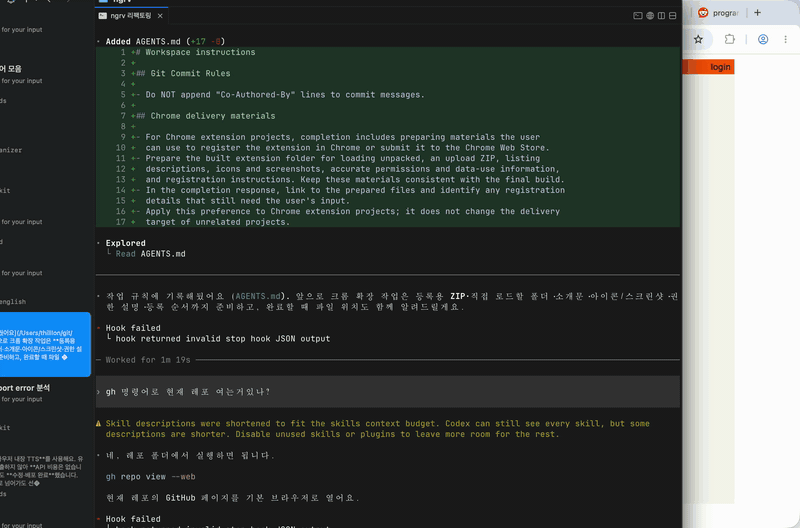

# Tab Organizer: Chrome Web Store Listing

> **This file is the single source of truth for the [Chrome Web Store listing](https://chromewebstore.google.com/detail/tab-organizer/bmbpmnfhfbdjdjpblimidmbohgccmjdg).**
> Everything shown on the store page (text, images, video, privacy disclosures) is kept here so the store and GitHub never drift apart.
> The store's Description field only accepts plain text, so the [Description](#description) below is kept as plain text inside a code block: what is in the block is what gets pasted. Nothing is generated from this file.
> The listing is localized: English is the default, and [Localized listings](#localized-listings) holds the Korean, Spanish and Japanese Summary and Description.

## Store listing

### Product details

| Field       | Value                                                       | Where it comes from                                                                                                                |
| ----------- | ----------------------------------------------------------- | ---------------------------------------------------------------------------------------------------------------------------------- |
| Title       | Tab Organizer                                               | `extName` in `public/_locales/<lang>/messages.json` → manifest `name` (`__MSG_extName__`)                                          |
| Summary     | See [Summary](#summary)                                     | `extDescription` in `public/_locales/<lang>/messages.json` → manifest `description` (`__MSG_extDescription__`, max 132 characters) |
| Category    | Extensions › Functionality & UI                             | Developer Dashboard                                                                                                                |
| Language    | English (default), Korean (ko), Spanish (es), Japanese (ja) | The folders of `public/_locales/`; the manifest's `default_locale` is `en`                                                         |
| Description | See below                                                   | The code block under [Description](#description), and one per language under [Localized listings](#localized-listings)             |

The store reads the Title and Summary of every language out of the uploaded package (the manifest's `__MSG_extName__` / `__MSG_extDescription__` resolved through that language's `messages.json`), so they cannot be typed into the dashboard: change them in `public/_locales/`. The Summary blocks in this file are copies kept for review, and `pnpm test` fails when one differs from its `extDescription` or exceeds 132 characters. `package.json` `description` stays equal to the English one.

### Summary

```text
Sort and group every tab in one click, then save and restore whole windows as sessions. Offline, no account, stays on your device.
```

### Description

Paste the block below into the store's **Description** field as it is. The field takes plain text only, so there is no Markdown in it. On GitHub the copy button at the block's top-right corner takes the whole text.

```text
Tab Organizer: One-Click Tab Sorting + a Full Session Manager for Chrome

Tired of dozens of messy, unorganized tabs cluttering your browser? Tab Organizer instantly sorts and groups all your tabs with a single click. No popup, no complicated setup, no account required, no data ever leaves your browser.

Just pin the extension icon to your toolbar and click it. That's it. Your tabs are instantly organized.

Need to put a project away for later? Right-click the icon → Save session, or → Options to open Tab Organizer itself. Tab Organizer saves every window, tab, pinned tab and tab group exactly as it is and restores it later with one click. A full-page dashboard shows your open windows, saved sessions and history side by side, searches across all of them, and imports and exports in JSON, Markdown, text, HTML bookmarks or CSV. Automatic snapshots of your open windows are taken every 5 minutes so you can recover after a crash. They are stored only on this device, never uploaded, and can be turned off at any time.

HOW IT WORKS

Click the Tab Organizer icon in your toolbar. Every tab in your current window is immediately sorted and organized. There's no popup and no extra steps: one click and you're done.

Right-click the icon for everything else: "Assemble!" (gather every window's tabs into this one) and "Save all windows as session"; a ✓ badge on the icon confirms a save. Chrome's own "Options" item in the same menu opens Tab Organizer, the full page where your tabs, sessions, snapshots and settings live.

Tab Organizer handles three types of tabs independently:
• Pinned tabs (optionally sorted)
• Tab groups (sorted by group name, then tabs within each group are sorted)
• Ungrouped tabs (sorted and optionally grouped by website)

After sorting, duplicate tabs are handled according to your preference.

FEATURES

▸ One-Click Sorting
Click the extension icon to instantly sort all tabs in your current window. No menus, no dialogs, just instant organization.

▸ Multiple Sort Modes
Choose how your tabs are sorted:
• By URL: Sorts tabs alphabetically by their web address. Tabs from the same website are grouped together naturally.
• By Title: Sorts tabs alphabetically by their page title.
• Custom Grouping: Groups tabs by website (hostname or domain), preserving the order in which you first visited each site.

▸ Smart Tab Grouping
When using Custom Grouping mode, tabs are grouped by website. You can choose between two grouping levels:
• Subdomain mode: mail.google.com, drive.google.com, and docs.google.com are treated as separate groups.
• Domain mode: All Google services are merged into a single google.com group. This also handles special two-part TLDs like .co.uk, .com.au, and .ac.kr correctly.

▸ Tab Group Support
Tab Organizer fully supports Chrome's native tab groups. It sorts your existing tab groups alphabetically by their group name, then sorts the tabs within each group. You can prefix group names with numbers (e.g., "1-Work", "2-Personal") to set a custom order.

▸ Duplicate Tab Detection
How many times have you opened the same page in multiple tabs? Tab Organizer can help:
• Keep one (the default): Close the extra copies, keeping the active one (or the first one).
• Keep all: Leave duplicates as they are.
• Group them: Move duplicates into a labeled Chrome tab group so you can review them before closing.

▸ Gather All Windows Into One
Right-click the icon → "Assemble!" (or use a keyboard shortcut) and the tabs of every other window move into the one you are using. Tabs are moved, never reopened, so pinned tabs, tab groups, history and anything you typed stay as they were, and the tab you are looking at stays in front. Incognito and popup windows are left alone.

▸ Pinned Tab Sorting
By default, pinned tabs are left in their original order. If you prefer, you can enable pinned tab sorting in the settings to include them in the sort.

▸ Suspended Tab Support
If you use "The Marvellous Suspender" extension to save memory, Tab Organizer can detect suspended tabs and either:
• Sort them by their original URL (treating them like normal tabs)
• Group all suspended tabs together at the beginning for easy identification

▸ Grouping Direction
When using Custom Grouping, you can choose the grouping direction:
• Left to Right: Groups are ordered by the first tab you opened from each website (natural browsing order).
• Right to Left: Groups are ordered in reverse, starting from the most recently opened websites.

▸ Preserve Order Within Groups
In Custom Grouping mode, you can optionally preserve the original tab order within each group. This is useful if the order you opened tabs matters (e.g., reading articles in sequence).

SESSIONS

Save what you have open, close it, and bring it all back later, Session Buddy-style, with nothing leaving your computer.

▸ Save a Session in One Action
Right-click the Tab Organizer icon and choose "Save all windows as session", press a keyboard shortcut you assign, or use the Save button on the Open tabs screen. Every window is captured with its tabs in order, pinned tabs, the active tab, tab groups (name, color, collapsed state) and window size, position and state. Tabs suspended by The Marvellous Suspender are saved by their real URL. Incognito windows, empty windows and Tab Organizer's own pages are never captured.

▸ Restore Exactly
Pick a session and click Restore. Windows are recreated with the same tab order, pinned tabs, active tab, tab groups (including collapsed ones) and window state. Restore a whole session or a single window, or choose "Restore into this window" to append a saved window's tabs and groups to the window you are in. Large restores run in small batches with a progress indicator and a Cancel button; sessions with more than 50 tabs are opened lazily (tabs load when you click them) so Chrome stays responsive, and restores of more than 100 tabs ask for confirmation first. Pages Chrome cannot open (javascript: or data: URLs, other extensions' pages, file:// pages when file access is not allowed) are skipped and listed in the result; nothing else is affected. Restoring never deletes the saved session.

▸ One Page For Everything
One full page, not a cramped popup, and not a separate settings page either. The left column lists what you have: open tabs, saved sessions, and automatic snapshots folded away at the bottom. The rest of the page shows whichever one you picked. Rename a session by clicking its title; remove a tab or a window from it, export it, delete it. Click a saved tab to open it; if that page is already open, Tab Organizer switches to it instead of opening a second copy. Settings live behind the ⚙ button on the same page, and every view has its own address, so Back works and a session can be bookmarked. It follows your system's light or dark setting, and it is only ever one tab.

▸ Automatic Snapshots and Crash Recovery
Every 5 minutes (or an interval you choose) Tab Organizer takes a snapshot of all your open windows, but only when something actually changed. It keeps the 20 most recent snapshots (you choose how many) and drops the oldest automatically; protect a snapshot to keep it for good, or save it as a regular session. After Chrome restarts, the last snapshot becomes "Previous session (recovered)", is protected, and is pointed out in the dashboard so you can get everything back after a crash. Snapshots are on by default and live only on this device. Turn them off in Options or in the dashboard settings and no timer exists at all.

▸ Unified Search
One search box finds tabs across your open windows, saved sessions and (optionally) history by title, URL or site. Results are grouped by source with counts, best matches first. Press / to jump to the search box, Esc to clear it, the arrow keys to move through results and Enter to open the highlighted one.

▸ Import, Export and Copy
Export a tab group, a window or a session as JSON (which imports back exactly), Markdown, plain text (one URL per line), Netscape HTML (imports straight into Chrome's bookmark manager) or CSV, and every saved session at once as a single JSON backup. "Copy links" and "Copy as Markdown" put any row on your clipboard. Import from a file or by pasting: Tab Organizer JSON, HTML bookmark exports, Markdown link lists and plain URL lists (a blank line starts a new window), with a preview of what will be created before anything is saved.

▸ Keyboard Shortcuts
Four commands can be bound in Chrome's shortcut settings (chrome://extensions/shortcuts): sort the current window (what a click on the icon does), save the current window as a session, open Tab Organizer, and gather every window's tabs into the current one. Sorting starts as Alt+Shift+S and gathering as Alt+Shift+A (Option on a Mac) where free; the others start unset. Settings lists the keys you have assigned and takes you straight there.

▸ Local-First, Always
Saved sessions and snapshots are stored in Chrome's local extension storage on this device. They are not synced, not uploaded, and not readable by any web page. A storage meter in the dashboard shows how much space sessions use, and "Delete all session data" removes every session and snapshot in one action, keeping your settings. Uninstalling the extension removes everything as well.

SETTINGS

Press ⚙ Settings on the Tab Organizer page (Chrome's own "Options" item opens the same screen) to configure:
• Sort by: URL, title or Custom. Custom adds, right below it:
  - Tab groups: by full hostname (mail.google.com ≠ drive.google.com) or by domain (all *.google.com together)
  - Grouping direction and whether each site keeps its own tab order
• Duplicate tabs
  - Keep one (the default): Close the extra copies
  - Keep all: Leave duplicate tabs as they are
  - Group them: Collect duplicates into a labeled group for review
• Sessions
  - Automatic snapshots: on or off; interval, how many to keep and lazy restore under Advanced
  - Backup: export everything, import, storage used, delete everything
  - Keyboard shortcuts: the keys you have assigned, and a way to change them

PRIVACY & SECURITY

Tab Organizer is designed with privacy as a core principle:
• Zero data collection: No analytics, no tracking, no telemetry.
• Zero network requests: The extension never makes any HTTP requests. It works entirely offline.
• Only the permissions it needs, each with one job:
  - "tabs": reads tab URLs and titles to sort them and to save sessions; creates tabs when restoring
  - "tabGroups": creates and manages Chrome tab groups, and recreates them from sessions
  - "storage": saves your preferences via Chrome sync storage; saved sessions and snapshots (tab URLs, titles, group names, window layout) are kept in local storage on this device only
  - "contextMenus": adds the Assemble! and Save items to the icon's right-click menu
  - "unlimitedStorage": lets large saved sessions exceed Chrome's 10 MB local quota; data stays on the device
  - "favicon": shows site icons from Chrome's local favicon cache, no network
  - "alarms": the timer for automatic snapshots (every 5 minutes by default); turn snapshots off and no timer exists
• No host permissions and no content scripts: Tab Organizer never reads or injects code into any web page.
• No background network activity: The service worker wakes only for short, local work (when you use the extension, when Chrome starts or the extension updates, when you change a setting, and on the interval you choose while automatic snapshots are on). It never contacts the network.
• Open and transparent: The extension does exactly what it says, nothing more.

Your browsing data stays on your device. Always.

USE CASES

• Research sessions: 30+ tabs across Google Scholar, Wikipedia and journals: one click groups them by source, one more saves the set for tomorrow.
• Work vs. personal: Save your work windows as a session on Friday, close them, restore them on Monday exactly as they were.
• Duplicate cleanup: The same Stack Overflow answer open five times? Let Tab Organizer find and close the duplicates.
• Crash recovery: Chrome died with 200 tabs open. Open Tab Organizer; the recovered snapshot is marked in the list, open it, and carry on.

FAQ

Q: Does Tab Organizer work across multiple windows?
A: Sorting works on the currently focused window. Click the icon in each window you want to organize. Sessions can cover every window at once ("Save all windows as session").

Q: Will it mess up my pinned tabs?
A: No. Pinned tabs are left untouched by default. You can optionally enable pinned tab sorting in settings.

Q: Does it send my browsing data anywhere?
A: Absolutely not. Tab Organizer makes zero network requests. Everything happens locally in your browser.

Q: Where are my saved sessions stored?
A: In Chrome's local extension storage on this device only. Sessions are never synced, never uploaded and never shared with any web page. Delete a session from the dashboard whenever you like, use "Delete all session data" to remove everything, or uninstall the extension and Chrome removes all of it. Use Export (JSON) in the dashboard to keep your own backup.

Q: What do automatic snapshots record, and can I turn them off?
A: A snapshot is the same data as a saved session (tab URLs, titles, pinned state, tab groups and window layout), taken on the interval you choose (5 minutes by default) when something changed, and each time you click the icon to sort. The most recent unprotected snapshots are kept on this device (20 by default). Turn snapshots off in Options or in the dashboard settings; with snapshots off, no timer exists.

Q: How do I restore a session?
A: Right-click the icon → Options (or use the shortcut you assigned), pick the session in the left column and press Open, or Open window for a single window. Windows are recreated in new windows with the original order, pinned tabs, groups and active tab; "Restore into this window" adds a saved window's tabs to the window you are in instead. Restoring never deletes the saved session.

Q: Can I move sessions to another computer or another tool?
A: Yes. Export everything as JSON and import that file on the other machine, or export as Netscape HTML and import it into Chrome's bookmark manager. Markdown, plain text and CSV exports are for sharing and spreadsheets; plain URL lists and Markdown link lists can be pasted back in as new sessions.

Q: How much space do sessions take, and what happens when it runs out?
A: A tab takes a few hundred bytes, so even a thousand-tab session stays well under a megabyte; the storage meter in Settings shows the total. Old snapshots are dropped automatically, and you can delete any session, or all session data, at any time.

Q: Does saving a session change my open tabs?
A: No. Saving only reads your tabs. Sorting still happens only when you left-click the icon.

Q: What happens if I don't like the result?
A: Sorting only reorders tabs, so nothing is lost. Closed duplicates come back with Ctrl+Shift+T (Cmd+Shift+T on Mac).

Q: Does it support other Chromium browsers?
A: Tab Organizer needs Chrome 123 or newer and should work on any Chromium-based browser of that generation that supports Manifest V3 and the Tab Groups API, including Microsoft Edge and Brave.

TIPS

• Prefix your Chrome tab group names with numbers (e.g., "1-Priority", "2-Reference") to control their sort order.
• With Custom sorting, group tabs by domain if you use many Google or Microsoft services. It keeps their subdomains together.
• Try "Group them" for duplicate tabs before "Keep one". It lets you review which tabs will be affected before any are closed.
• Save a session before a big cleanup; closing tabs is free when you can bring them all back.

SUPPORT

If you encounter any issues or have feature requests, please file an issue on our GitHub repository (https://github.com/thilllon/tab-organizer/issues). We read every report and appreciate your feedback.
```

### Graphic assets

All images are generated by `pnpm release` (`scripts/prepare-registration.ts`) into `screenshots/`. Upload them in the order listed. Each optional step of that script can be skipped on its own with a `SKIP_*` environment flag (`SKIP_BUILD`, `SKIP_OPTIONS`, `SKIP_DASHBOARD`, `SKIP_DEMO`, `SKIP_NATIVE`, `SKIP_MOCKUPS`, `SKIP_PROMO`, `SKIP_GIF`), so one asset can be regenerated without redoing the rest. The demo video and its GIF are the exception: they are recorded only with `RECORD_VIDEO=1`, because the recording films the part of the screen where the Chrome window sits, so keep everything else off that screen while it runs, and watch the result before committing it.

Per-language screenshots: `LOCALES=en,ko,es,ja pnpm exec tsx scripts/prepare-registration.ts` shoots the Settings and dashboard screenshots once per UI language (Chromium started with `--lang=<code>` and the matching `LANGUAGE`/`LANG`, fixture session names in that language). English keeps the file names below in `screenshots/`; every other language writes the same names to `screenshots/<code>/`. Without `LOCALES` only English is shot, as before. `pnpm store:bundle` copies whatever exists into `package/store-<version>/screenshots/<code>/` and lists it per language in `SUBMIT.md`.

#### Store icon (128 × 128)

`public/img/logo-128.png`: also used as the manifest icon.


#### Screenshots (1280 × 800, up to 5)

1. `screenshots/before-sort.png`: tabs in random order

   

2. `screenshots/after-sort.png`: sorted and grouped by domain

   

3. `screenshots/dashboard-sessions.png`: the Sessions dashboard: open windows pane, saved sessions with an expanded window → group → tab tree, history section

   

4. `screenshots/dashboard-search.png`: unified search across open tabs, saved sessions and history

   

5. `screenshots/dashboard-restore.png`: a large restore in progress with the progress indicator and Cancel button

   

`scripts/prepare-registration.ts` captures five dashboard screenshots; the two not in the upload list above are kept as alternates: `screenshots/dashboard-import.png` (import dialog with its preview) and `screenshots/dashboard-history.png` (the History section with snapshots and the recovered entry). Also in the repository: `screenshots/screenshot-1280x800.png` (options page) and its 640 × 400 variant `screenshots/screenshot-640x400.png`, and the native macOS captures `screenshots/before-sort-native.png` / `screenshots/after-sort-native.png`.

#### Small promo tile (440 × 280)

`screenshots/promo-small-440x280.png`: regenerated by `pnpm release` with the v7 tagline "Sort tabs in one click · Save and restore sessions".


#### Marquee promo tile (1400 × 560)

`screenshots/promo-marquee-1400x560.png`: regenerated together with the small tile.


#### Promo video

The store only accepts a **YouTube URL** for the promo video; none is published yet. The demo recording lives in the repo:

- `screenshots/demo.mp4`: [download / play](../screenshots/demo.mp4)
- `screenshots/demo.gif`: preview generated from the video



### Additional fields

| Field          | Value                                             |
| -------------- | ------------------------------------------------- |
| Homepage URL   | https://thilllon.github.io/tab-organizer/         |
| Support URL    | https://thilllon.github.io/tab-organizer/support/ |
| Mature content | No                                                |

## Localized listings

The listing is localized through `public/_locales/`. Chrome picks the extension's own language from the browser's UI language (English, the manifest's `default_locale`, for anything else), and the Chrome Web Store does the same for the listing:

- **Title and Summary** of each language come from the uploaded package: the manifest's `__MSG_extName__` and `__MSG_extDescription__` resolved through `public/_locales/<lang>/messages.json`. The dashboard shows them read-only, so they are changed only there. The Summary blocks below are copies kept for review; `pnpm test` checks that each equals its `extDescription` and fits in 132 characters.
- **Description, screenshots, promo tiles and video** are typed or uploaded per language. In the [Developer Dashboard](https://chrome.google.com/webstore/devconsole), the Store listing tab has a language menu listing every locale in the package; pick one, paste its Description block from this file, upload its screenshots (`screenshots/<lang>/` when they exist), and save. A language left without its own Description or images shows the English (default) ones.
- Each block below is plain text pasted as it is, like the English one: no Markdown, the same `▸` and `•` conventions, Chrome's own terms in that language, and under 16,000 characters (`pnpm test` checks every language). Quoted menu items and buttons use the wording of that language's `messages.json`; when a translation there changes, change the quote here too.
- The promo tiles and the before/after mockups carry English text and are shared by every language.

### Summary (ko)

Korean. Read from `public/_locales/ko/messages.json` (`extDescription`); shown here for review only.

```text
클릭 한 번으로 모든 탭을 정렬하고 그룹으로 묶은 뒤, 창 전체를 세션으로 저장하고 복원합니다. 오프라인, 계정 불필요, 데이터는 기기에만 저장됩니다.
```

### Description (ko)

Korean. Paste into **Description** with the dashboard's language set to Korean.

```text
Tab Organizer: 클릭 한 번으로 탭 정렬 + Chrome용 세션 관리자

정리되지 않은 탭 수십 개가 브라우저를 가득 채우고 있나요? Tab Organizer는 클릭 한 번으로 모든 탭을 즉시 정렬하고 그룹으로 묶습니다. 팝업도, 복잡한 설정도, 계정도 필요 없으며 어떤 데이터도 브라우저 밖으로 나가지 않습니다.

확장 프로그램 아이콘을 툴바에 고정하고 클릭하세요. 그것으로 끝입니다. 탭이 바로 정리됩니다.

진행 중인 작업을 잠시 치워 두고 싶다면 아이콘을 마우스 오른쪽 버튼으로 클릭해 세션을 저장하거나, "옵션"을 눌러 Tab Organizer를 여세요. 모든 창, 탭, 고정된 탭, 탭 그룹을 있는 그대로 저장하고 나중에 클릭 한 번으로 복원합니다. 전체 페이지 대시보드에서 열린 창, 저장된 세션, 자동 스냅샷을 나란히 보고, 한꺼번에 검색하고, JSON, Markdown, 텍스트, HTML 북마크, CSV로 가져오고 내보낼 수 있습니다. 열린 창의 자동 스냅샷이 5분마다 만들어지므로 비정상 종료 후에도 복구할 수 있습니다. 스냅샷은 이 기기에만 저장되고 업로드되지 않으며 언제든지 끌 수 있습니다.

사용 방법

툴바의 Tab Organizer 아이콘을 클릭하세요. 현재 창의 모든 탭이 즉시 정렬되고 정리됩니다. 팝업도 추가 단계도 없이 클릭 한 번이면 끝납니다.

나머지 기능은 아이콘을 마우스 오른쪽 버튼으로 클릭하면 나옵니다. "모두 모으기"(모든 창의 탭을 이 창으로 모으기)와 "모든 창을 세션으로 저장"이 있고, 저장되면 아이콘에 ✓ 배지가 표시됩니다. 같은 메뉴에 있는 Chrome 기본 "옵션" 항목은 탭, 세션, 스냅샷, 설정이 모여 있는 Tab Organizer 페이지를 엽니다.

Tab Organizer는 세 종류의 탭을 각각 따로 처리합니다.
• 고정된 탭(원하면 정렬)
• 탭 그룹(그룹 이름순으로 정렬한 다음 각 그룹 안의 탭을 정렬)
• 그룹에 속하지 않은 탭(정렬하고, 원하면 웹사이트별로 그룹화)

정렬이 끝나면 중복 탭은 설정에 따라 처리됩니다.

기능

▸ 클릭 한 번으로 정렬
확장 프로그램 아이콘을 클릭하면 현재 창의 모든 탭이 즉시 정렬됩니다. 메뉴도 대화상자도 없이 바로 정리됩니다.

▸ 여러 가지 정렬 방식
탭을 정렬할 방식을 고르세요.
• URL순: 웹 주소의 알파벳순으로 정렬합니다. 같은 웹사이트의 탭이 자연스럽게 모입니다.
• 제목순: 페이지 제목순으로 정렬합니다.
• 사용자 지정 그룹화: 웹사이트(호스트 이름 또는 도메인)별로 탭을 묶고, 각 사이트를 처음 방문한 순서를 유지합니다.

▸ 스마트 탭 그룹화
사용자 지정 그룹화 모드에서는 웹사이트별로 탭을 묶습니다. 묶는 단위는 두 가지 중에서 고를 수 있습니다.
• 하위 도메인 모드: mail.google.com, drive.google.com, docs.google.com을 각각 다른 그룹으로 처리합니다.
• 도메인 모드: 모든 Google 서비스를 google.com 그룹 하나로 합칩니다. .co.uk, .com.au, .ac.kr 같은 2단계 최상위 도메인도 올바르게 처리합니다.

▸ 탭 그룹 지원
Chrome 기본 탭 그룹을 완벽하게 지원합니다. 기존 탭 그룹을 그룹 이름순으로 정렬한 다음 각 그룹 안의 탭을 정렬합니다. 그룹 이름 앞에 숫자를 붙이면(예: "1-업무", "2-개인") 원하는 순서를 정할 수 있습니다.

▸ 중복 탭 감지
같은 페이지를 여러 탭에 열어 둔 적이 있나요? Tab Organizer가 도와드립니다.
• 하나만 남기기(기본값): 나머지 사본을 닫고 활성 탭(또는 첫 번째 탭)을 남깁니다.
• 모두 유지: 중복 탭을 그대로 둡니다.
• 그룹으로 묶기: 중복 탭을 이름이 붙은 Chrome 탭 그룹으로 옮겨 닫기 전에 확인할 수 있게 합니다.

▸ 모든 창을 하나로 모으기
아이콘을 마우스 오른쪽 버튼으로 클릭하고 "모두 모으기"를 선택하면(또는 단축키를 누르면) 다른 모든 창의 탭이 지금 사용 중인 창으로 옮겨집니다. 탭을 다시 여는 것이 아니라 옮기기 때문에 고정된 탭, 탭 그룹, 방문 기록, 입력한 내용이 그대로 유지되고 보고 있던 탭도 그대로 앞에 있습니다. 시크릿 창과 팝업 창은 건드리지 않습니다.

▸ 고정된 탭 정렬
기본적으로 고정된 탭은 원래 순서를 유지합니다. 원한다면 설정에서 고정된 탭 정렬을 켜서 정렬에 포함할 수 있습니다.

▸ 일시 중지된 탭 지원
메모리를 아끼려고 "The Marvellous Suspender" 확장 프로그램을 사용한다면, Tab Organizer가 일시 중지된 탭을 감지해 다음 중 하나로 처리합니다.
• 원래 URL 기준으로 정렬(일반 탭처럼 취급)
• 일시 중지된 탭을 모두 맨 앞에 모아 한눈에 알아보기 쉽게 표시

▸ 그룹화 방향
사용자 지정 그룹화에서 그룹을 나열하는 방향을 고를 수 있습니다.
• 왼쪽에서 오른쪽: 각 웹사이트에서 처음 연 탭을 기준으로 그룹을 나열합니다(자연스러운 탐색 순서).
• 오른쪽에서 왼쪽: 가장 최근에 연 웹사이트부터 역순으로 나열합니다.

▸ 그룹 안의 순서 유지
사용자 지정 그룹화 모드에서 각 그룹 안의 원래 탭 순서를 유지할 수 있습니다. 탭을 연 순서가 중요할 때(예: 글을 차례대로 읽을 때) 유용합니다.

세션

열어 둔 것을 저장하고, 닫고, 나중에 전부 되돌려 놓으세요. Session Buddy처럼 쓰면서도 컴퓨터 밖으로는 아무것도 나가지 않습니다.

▸ 한 번에 세션 저장
Tab Organizer 아이콘을 마우스 오른쪽 버튼으로 클릭해 "모든 창을 세션으로 저장"을 선택하거나, 직접 지정한 단축키를 누르거나, 열린 탭 화면의 저장 버튼을 사용하세요. 모든 창이 탭 순서, 고정된 탭, 활성 탭, 탭 그룹(이름, 색상, 접힘 상태), 창 크기와 위치와 상태까지 그대로 저장됩니다. The Marvellous Suspender로 일시 중지된 탭은 실제 URL로 저장됩니다. 시크릿 창, 빈 창, Tab Organizer 자체 페이지는 저장하지 않습니다.

▸ 정확한 복원
세션을 고르고 열기를 누르세요. 탭 순서, 고정된 탭, 활성 탭, 탭 그룹(접힌 그룹 포함), 창 상태가 같은 창이 다시 만들어집니다. 세션 전체나 창 하나만 복원할 수도 있고, "이 창에서 열기"를 선택해 저장된 창의 탭과 그룹을 지금 창에 추가할 수도 있습니다. 대량 복원은 진행률 표시와 취소 버튼과 함께 작은 단위로 나누어 실행됩니다. 탭이 50개를 넘는 세션은 지연 로드되어(탭을 클릭할 때 로드) Chrome이 느려지지 않으며, 탭 100개가 넘는 복원은 먼저 확인을 요청합니다. Chrome이 열 수 없는 페이지(javascript: 또는 data: URL, 다른 확장 프로그램의 페이지, 파일 액세스가 허용되지 않은 file:// 페이지)는 건너뛰고 결과에 표시하며, 다른 탭에는 영향을 주지 않습니다. 복원해도 저장된 세션은 삭제되지 않습니다.

▸ 모든 것을 한 페이지에서
좁은 팝업도, 따로 떨어진 설정 페이지도 아닌 전체 페이지 하나입니다. 왼쪽 열에는 열린 탭, 저장된 세션, 그리고 아래쪽에 접혀 있는 자동 스냅샷이 표시되고, 나머지 영역에는 선택한 항목이 표시됩니다. 제목을 클릭해 세션 이름을 바꾸고, 세션에서 탭이나 창을 빼고, 내보내고, 삭제할 수 있습니다. 저장된 탭을 클릭하면 열리며, 그 페이지가 이미 열려 있으면 두 번째 사본을 여는 대신 해당 탭으로 전환합니다. 설정은 같은 페이지의 ⚙ 버튼에 있고, 모든 화면에 고유한 주소가 있어서 뒤로 가기가 작동하고 세션을 북마크할 수 있습니다. 시스템의 밝은 모드/어두운 모드 설정을 따르며, 언제나 탭 하나만 사용합니다.

▸ 자동 스냅샷과 비정상 종료 복구
5분마다(또는 원하는 간격으로) Tab Organizer가 열린 모든 창의 스냅샷을 만듭니다. 단, 실제로 무언가 바뀌었을 때만 만듭니다. 최근 스냅샷 20개(개수는 직접 정할 수 있음)를 보관하고 가장 오래된 것부터 자동으로 삭제합니다. 스냅샷을 보호하면 계속 보관되며, 일반 세션으로 저장할 수도 있습니다. Chrome을 다시 시작하면 마지막 스냅샷이 "이전 세션(복구됨)"이 되어 보호되고 대시보드에 표시되므로, 비정상 종료 후에도 모든 것을 되찾을 수 있습니다. 스냅샷은 기본적으로 켜져 있으며 이 기기에만 저장됩니다. 옵션이나 대시보드 설정에서 끄면 타이머가 아예 존재하지 않습니다.

▸ 통합 검색
검색창 하나로 열린 창, 저장된 세션, (원하면) 자동 스냅샷에 있는 탭을 제목, URL, 사이트로 찾습니다. 결과는 출처별로 개수와 함께 묶여 가장 잘 맞는 항목부터 표시됩니다. /를 누르면 검색창으로 이동하고, Esc로 지우고, 화살표 키로 결과 사이를 이동하고, Enter로 강조된 항목을 엽니다.

▸ 가져오기, 내보내기, 복사
탭 그룹, 창, 세션을 JSON(그대로 다시 가져올 수 있음), Markdown, 일반 텍스트(한 줄에 URL 하나), Netscape HTML(Chrome 북마크 관리자로 바로 가져올 수 있음), CSV로 내보낼 수 있고, 저장된 모든 세션을 한 번에 JSON 백업 파일 하나로 내보낼 수도 있습니다. "링크 복사"와 "Markdown으로 복사"로 어떤 행이든 클립보드에 담을 수 있습니다. 가져오기는 파일이나 붙여넣기로 할 수 있으며 Tab Organizer JSON, HTML 북마크 내보내기 파일, Markdown 링크 목록, 일반 URL 목록(빈 줄은 새 창의 시작)을 지원하고, 저장하기 전에 무엇이 만들어질지 미리 보여줍니다.

▸ 단축키
Chrome 단축키 설정(chrome://extensions/shortcuts)에서 네 가지 명령에 키를 지정할 수 있습니다. 현재 창 정렬(아이콘 클릭과 같은 동작), 현재 창을 세션으로 저장, Tab Organizer 열기, 모든 창의 탭을 현재 창으로 모으기입니다. 다른 곳에서 쓰지 않는 키라면 정렬은 Alt+Shift+S, 모으기는 Alt+Shift+A(Mac에서는 Option)로 시작하고, 나머지 둘은 지정되지 않은 상태로 시작합니다. 설정에서 지정한 키를 확인하고 바로 변경 화면으로 이동할 수 있습니다.

▸ 언제나 로컬 우선
저장된 세션과 스냅샷은 이 기기의 Chrome 로컬 확장 프로그램 저장소에 저장됩니다. 동기화되지 않고, 업로드되지 않으며, 어떤 웹페이지도 읽을 수 없습니다. 대시보드의 저장 공간 표시로 세션이 쓰는 용량을 확인할 수 있고, "모든 세션 데이터 삭제"로 설정은 그대로 둔 채 모든 세션과 스냅샷을 한 번에 삭제할 수 있습니다. 확장 프로그램을 삭제해도 모든 데이터가 함께 삭제됩니다.

설정

Tab Organizer 페이지에서 ⚙ 설정을 누르면(Chrome 기본 "옵션" 항목도 같은 화면을 엽니다) 다음을 설정할 수 있습니다.
• 정렬 기준: URL, 제목, 사용자 지정. 사용자 지정을 고르면 바로 아래에 다음 항목이 추가됩니다.
  - 탭 그룹: 전체 호스트 이름 기준(mail.google.com ≠ drive.google.com) 또는 도메인 기준(*.google.com 전체를 함께)
  - 그룹화 방향, 그리고 각 사이트의 탭 순서 유지 여부
• 중복 탭
  - 하나만 남기기(기본값): 나머지 사본을 닫습니다
  - 모두 유지: 중복 탭을 그대로 둡니다
  - 그룹으로 묶기: 중복 탭을 이름이 붙은 그룹에 모아 확인합니다
• 세션
  - 자동 스냅샷: 켜기 또는 끄기. 간격, 보관 개수, 지연 복원은 "고급"에 있습니다
  - 백업: 모두 내보내기, 가져오기, 사용 중인 저장 공간, 전체 삭제
  - 단축키: 지정한 키와 변경 방법

개인정보 보호 및 보안

Tab Organizer는 개인정보 보호를 핵심 원칙으로 설계되었습니다.
• 데이터 수집 없음: 분석, 추적, 원격 측정이 없습니다.
• 네트워크 요청 없음: 확장 프로그램은 HTTP 요청을 전혀 보내지 않으며 완전히 오프라인으로 작동합니다.
• 꼭 필요한 권한만, 각각 하나의 용도로 사용합니다.
  - "tabs": 탭 URL과 제목을 읽어 정렬하고 세션을 저장하며, 복원할 때 탭을 만듭니다
  - "tabGroups": Chrome 탭 그룹을 만들고 관리하며, 세션에서 탭 그룹을 다시 만듭니다
  - "storage": 환경설정을 Chrome 동기화 저장소에 저장합니다. 저장된 세션과 스냅샷(탭 URL, 제목, 그룹 이름, 창 배치)은 이 기기의 로컬 저장소에만 보관됩니다
  - "contextMenus": 아이콘의 마우스 오른쪽 버튼 메뉴에 모두 모으기와 저장 항목을 추가합니다
  - "unlimitedStorage": 큰 세션이 Chrome의 로컬 저장 한도 10MB를 넘을 수 있게 합니다. 데이터는 기기에 남습니다
  - "favicon": Chrome의 로컬 파비콘 캐시에서 사이트 아이콘을 표시합니다. 네트워크를 쓰지 않습니다
  - "alarms": 자동 스냅샷 타이머(기본값 5분마다). 스냅샷을 끄면 타이머가 존재하지 않습니다
• 호스트 권한도 콘텐츠 스크립트도 없음: Tab Organizer는 어떤 웹페이지도 읽거나 코드를 삽입하지 않습니다.
• 백그라운드 네트워크 활동 없음: 서비스 워커는 짧은 로컬 작업을 할 때만 깨어납니다(확장 프로그램을 사용할 때, Chrome이 시작되거나 확장 프로그램이 업데이트될 때, 설정을 바꿀 때, 그리고 자동 스냅샷이 켜져 있는 동안 지정한 간격마다). 네트워크에는 절대 연결하지 않습니다.
• 투명한 동작: 확장 프로그램은 설명한 일만 하며, 그 이상은 하지 않습니다.

탐색 데이터는 언제나 사용자의 기기에 남습니다.

활용 예시

• 리서치: Google 학술검색, 위키백과, 학술지에 걸친 30개가 넘는 탭을 클릭 한 번으로 출처별로 묶고, 한 번 더 클릭해 내일을 위해 저장합니다.
• 업무와 개인 생활 분리: 금요일에 업무 창을 세션으로 저장하고 닫은 다음, 월요일에 그대로 복원합니다.
• 중복 정리: 같은 Stack Overflow 답변이 다섯 번 열려 있나요? Tab Organizer가 중복 탭을 찾아 닫습니다.
• 비정상 종료 복구: 탭 200개를 연 채로 Chrome이 종료되었습니다. Tab Organizer를 열면 목록에 복구된 스냅샷이 표시되어 있으니, 열고 하던 일을 계속하세요.

자주 묻는 질문

Q: 여러 창에서도 작동하나요?
A: 정렬은 현재 포커스된 창에서 작동합니다. 정리하려는 창마다 아이콘을 클릭하세요. 세션은 모든 창을 한 번에 저장할 수 있습니다("모든 창을 세션으로 저장").

Q: 고정된 탭이 흐트러지지 않나요?
A: 아니요. 기본적으로 고정된 탭은 건드리지 않습니다. 원하면 설정에서 고정된 탭 정렬을 켤 수 있습니다.

Q: 탐색 데이터를 어딘가로 보내나요?
A: 절대 보내지 않습니다. Tab Organizer는 네트워크 요청을 전혀 하지 않으며, 모든 작업은 브라우저 안에서 로컬로 처리됩니다.

Q: 저장된 세션은 어디에 보관되나요?
A: 이 기기의 Chrome 로컬 확장 프로그램 저장소에만 보관됩니다. 세션은 동기화되거나 업로드되거나 웹페이지와 공유되지 않습니다. 대시보드에서 언제든지 세션을 삭제할 수 있고, "모든 세션 데이터 삭제"로 전부 지우거나, 확장 프로그램을 삭제하면 Chrome이 모두 지웁니다. 대시보드의 내보내기(JSON)로 직접 백업을 보관할 수 있습니다.

Q: 자동 스냅샷은 무엇을 기록하고, 끌 수 있나요?
A: 스냅샷은 저장된 세션과 같은 데이터(탭 URL, 제목, 고정 상태, 탭 그룹, 창 배치)입니다. 변경 사항이 있을 때 지정한 간격(기본값 5분)마다, 그리고 아이콘을 클릭해 정렬할 때마다 만들어집니다. 보호되지 않은 최근 스냅샷이 이 기기에 보관됩니다(기본값 20개). 옵션이나 대시보드 설정에서 스냅샷을 끌 수 있으며, 끄면 타이머가 존재하지 않습니다.

Q: 세션은 어떻게 복원하나요?
A: 아이콘을 마우스 오른쪽 버튼으로 클릭하고 "옵션"을 선택하거나(또는 지정한 단축키를 누르고), 왼쪽 열에서 세션을 고른 뒤 열기를 누르세요. 창 하나만 열려면 창 열기를 누르세요. 원래 순서, 고정된 탭, 그룹, 활성 탭이 그대로인 새 창이 만들어집니다. "이 창에서 열기"를 고르면 저장된 창의 탭을 지금 창에 추가합니다. 복원해도 저장된 세션은 삭제되지 않습니다.

Q: 세션을 다른 컴퓨터나 다른 도구로 옮길 수 있나요?
A: 네. 전체를 JSON으로 내보내 다른 컴퓨터에서 가져오거나, Netscape HTML로 내보내 Chrome 북마크 관리자로 가져오세요. Markdown, 일반 텍스트, CSV 내보내기는 공유와 스프레드시트용입니다. 일반 URL 목록과 Markdown 링크 목록은 붙여넣어 새 세션으로 가져올 수 있습니다.

Q: 세션은 공간을 얼마나 차지하고, 공간이 부족하면 어떻게 되나요?
A: 탭 하나는 수백 바이트이므로 탭 1,000개짜리 세션도 1MB에 한참 못 미칩니다. 설정의 저장 공간 표시에서 전체 사용량을 볼 수 있습니다. 오래된 스냅샷은 자동으로 삭제되며, 언제든지 세션이나 모든 세션 데이터를 삭제할 수 있습니다.

Q: 세션을 저장하면 열린 탭이 바뀌나요?
A: 아니요. 저장은 탭을 읽기만 합니다. 정렬은 아이콘을 왼쪽 클릭할 때만 일어납니다.

Q: 결과가 마음에 들지 않으면요?
A: 정렬은 탭 순서만 바꾸므로 잃어버리는 것이 없습니다. 닫힌 중복 탭은 Ctrl+Shift+T(Mac에서는 Cmd+Shift+T)로 되살릴 수 있습니다.

Q: 다른 Chromium 브라우저도 지원하나요?
A: Tab Organizer는 Chrome 123 이상이 필요하며, Manifest V3와 탭 그룹 API를 지원하는 같은 세대의 Chromium 기반 브라우저(Microsoft Edge, Brave 포함)에서도 작동할 것입니다.

팁

• Chrome 탭 그룹 이름 앞에 숫자를 붙이면(예: "1-중요", "2-참고") 정렬 순서를 정할 수 있습니다.
• Google이나 Microsoft 서비스를 많이 쓴다면 사용자 지정 정렬에서 도메인 기준으로 묶어 보세요. 하위 도메인이 한데 모입니다.
• 중복 탭은 "하나만 남기기"보다 "그룹으로 묶기"를 먼저 써 보세요. 탭을 닫기 전에 어떤 탭이 영향을 받는지 확인할 수 있습니다.
• 대청소 전에 세션을 저장하세요. 전부 되돌릴 수 있으니 부담 없이 탭을 닫을 수 있습니다.

지원

문제가 있거나 원하는 기능이 있다면 GitHub 저장소(https://github.com/thilllon/tab-organizer/issues)에 이슈를 등록해 주세요. 모든 보고를 읽고 있으며, 의견을 보내 주셔서 감사합니다.
```

### Summary (es)

Spanish. Read from `public/_locales/es/messages.json` (`extDescription`); shown here for review only.

```text
Ordena y agrupa todas las pestañas en un clic; guarda y restaura ventanas enteras como sesiones. Sin conexión ni cuenta, todo local.
```

### Description (es)

Spanish. Paste into **Description** with the dashboard's language set to Spanish.

```text
Tab Organizer: ordena tus pestañas con un clic y gestiona sesiones completas en Chrome

¿Decenas de pestañas desordenadas llenando el navegador? Tab Organizer ordena y agrupa todas tus pestañas con un solo clic. Sin ventana emergente, sin configuración complicada, sin cuenta y sin que ningún dato salga de tu navegador.

Fija el icono de la extensión en la barra de herramientas y haz clic en él. Eso es todo: tus pestañas quedan ordenadas al instante.

¿Quieres apartar un proyecto para más tarde? Haz clic derecho en el icono para guardar la sesión, o elige Opciones para abrir Tab Organizer. Guarda cada ventana, pestaña, pestaña fijada y grupo tal como están y lo restaura con un clic. Un panel a página completa muestra tus ventanas abiertas, sesiones guardadas e instantáneas automáticas, busca en todo e importa y exporta en JSON, Markdown, texto, marcadores HTML o CSV. Cada 5 minutos se toma una instantánea automática de tus ventanas para recuperarte tras un cierre inesperado; se guarda solo en este dispositivo y puedes desactivarlas cuando quieras.

CÓMO FUNCIONA

Haz clic en el icono de Tab Organizer: todas las pestañas de la ventana actual se ordenan al momento, sin pasos extra.

Todo lo demás está en el menú del clic derecho: "¡Reunir!" (trae a esta ventana las pestañas de todas las demás) y "Guardar todas las ventanas como sesión"; una marca ✓ en el icono confirma que se ha guardado. El elemento "Opciones" de Chrome en ese mismo menú abre Tab Organizer, la página donde están tus pestañas, sesiones, instantáneas y configuración.

Tab Organizer trata por separado tres tipos de pestañas:
• Pestañas fijadas (se ordenan solo si lo activas)
• Grupos de pestañas (ordenados por nombre y, dentro de cada grupo, sus pestañas)
• Pestañas sin grupo (ordenadas y, si quieres, agrupadas por sitio web)

Después de ordenar, las pestañas duplicadas se tratan según tu preferencia.

FUNCIONES

▸ Ordenar con un clic
Haz clic en el icono de la extensión y todas las pestañas de la ventana actual se ordenan al instante, sin menús ni diálogos.

▸ Varios modos de orden
• Por URL: orden alfabético por dirección web; las pestañas del mismo sitio quedan juntas.
• Por título: orden alfabético por el título de la página.
• Agrupación personalizada: agrupa por sitio web (nombre de host o dominio) respetando el orden en que visitaste cada sitio por primera vez.

▸ Agrupación inteligente
En la agrupación personalizada eliges el nivel:
• Subdominio: mail.google.com, drive.google.com y docs.google.com son grupos distintos.
• Dominio: todos los servicios de Google se unen en un único grupo google.com. También reconoce dominios de dos partes como .co.uk, .com.au o .ac.kr.

▸ Compatible con los grupos de pestañas
Tab Organizer ordena tus grupos de pestañas de Chrome por nombre y luego las pestañas de cada grupo. Pon números delante de los nombres (por ejemplo, "1-Trabajo", "2-Personal") para fijar tu propio orden.

▸ Detección de pestañas duplicadas
¿La misma página abierta en varias pestañas? Tú eliges:
• Conservar una (predeterminado): cierra las copias y conserva la activa (o la primera).
• Conservar todas: deja los duplicados como están.
• Agruparlas: mueve los duplicados a un grupo de pestañas con nombre para revisarlos antes de cerrarlos.

▸ Reunir todas las ventanas en una
Haz clic derecho en el icono y elige "¡Reunir!" (o usa una combinación de teclas): las pestañas de las demás ventanas pasan a la que estás usando. Se mueven, no se vuelven a abrir, así que las pestañas fijadas, los grupos, el historial y lo que hayas escrito se mantienen, y la pestaña que estás viendo sigue delante. Las ventanas de incógnito y las emergentes no se tocan.

▸ Pestañas fijadas
Por defecto conservan su orden; puedes incluirlas en el orden desde la configuración.

▸ Pestañas suspendidas
Si usas la extensión "The Marvellous Suspender" para ahorrar memoria, Tab Organizer detecta las pestañas suspendidas y puede:
• Ordenarlas por su URL original, como pestañas normales
• Reunirlas todas al principio para identificarlas fácilmente

▸ Dirección de agrupación
En la agrupación personalizada:
• De izquierda a derecha: los grupos siguen la primera pestaña que abriste de cada sitio (orden natural de navegación).
• De derecha a izquierda: orden inverso, empezando por los sitios abiertos más recientemente.

▸ Mantener el orden dentro de los grupos
En la agrupación personalizada puedes conservar el orden original de las pestañas de cada grupo, útil si importa el orden en que las abriste.

SESIONES

Guarda lo que tienes abierto, ciérralo y recupéralo todo más tarde, al estilo de Session Buddy, sin que nada salga de tu ordenador.

▸ Guardar una sesión en un paso
Haz clic derecho en el icono y elige "Guardar todas las ventanas como sesión", pulsa tu combinación de teclas o usa el botón Guardar de Pestañas abiertas. Cada ventana se guarda con sus pestañas en orden, pestañas fijadas, pestaña activa, grupos (nombre, color y si están contraídos) y el tamaño, la posición y el estado de la ventana. Las pestañas suspendidas por The Marvellous Suspender se guardan con su URL real. Nunca se guardan ventanas de incógnito, ventanas vacías ni las páginas de Tab Organizer.

▸ Restauración exacta
Elige una sesión y pulsa Abrir. Las ventanas se recrean con el mismo orden, pestañas fijadas, pestaña activa, grupos (también los contraídos) y estado de ventana. Restaura la sesión entera o una sola ventana, o elige "Abrir en esta ventana" para añadir las pestañas y grupos de una ventana guardada a la ventana actual. Las restauraciones grandes avanzan por tandas con progreso y botón Cancelar; con más de 50 pestañas se abren en diferido (cada una se carga al hacer clic) y con más de 100 se pide confirmación. Las páginas que Chrome no puede abrir (javascript:, data:, páginas de otras extensiones, file:// sin acceso a archivos) se omiten y se indican en el resultado. Restaurar nunca elimina la sesión guardada.

▸ Todo en una página
Una página completa, no una ventana emergente estrecha. La columna izquierda muestra pestañas abiertas, sesiones guardadas y, plegadas al final, las instantáneas automáticas; el resto muestra lo que elijas. Haz clic en el título de una sesión para renombrarla; quita una pestaña o una ventana, expórtala o elimínala. Una pestaña guardada se abre con un clic; si ya está abierta, Tab Organizer cambia a ella en vez de duplicarla. La configuración está tras el botón ⚙, y cada vista tiene su propia dirección, así que el botón Atrás funciona y puedes guardar una sesión en marcadores. Sigue el modo claro u oscuro de tu sistema y siempre ocupa una sola pestaña.

▸ Instantáneas automáticas y recuperación
Cada 5 minutos (o el intervalo que elijas) Tab Organizer toma una instantánea de tus ventanas abiertas si algo ha cambiado. Conserva las 20 más recientes (tú eliges cuántas) y descarta las más antiguas; protege una instantánea para conservarla siempre o guárdala como sesión normal. Cuando Chrome se reinicia, la última instantánea pasa a ser "Sesión anterior (recuperada)", queda protegida y se señala en el panel para recuperarlo todo. Las instantáneas están activadas por defecto y viven solo en este dispositivo. Desactívalas en Opciones o en la configuración del panel y no existirá ningún temporizador.

▸ Búsqueda unificada
Una sola búsqueda encuentra pestañas en tus ventanas abiertas, sesiones guardadas y (si quieres) las instantáneas automáticas, por título, URL o sitio. Los resultados se agrupan por origen con su recuento, los mejores primero. Pulsa / para ir a la búsqueda, Esc para borrarla, las flechas para moverte y Intro para abrir el resultado resaltado.

▸ Importar, exportar y copiar
Exporta un grupo de pestañas, una ventana o una sesión en JSON (se reimporta tal cual), Markdown, texto sin formato (una URL por línea), HTML de Netscape (para el administrador de marcadores de Chrome) o CSV, y todas las sesiones a la vez como una copia de seguridad JSON. "Copiar enlaces" y "Copiar como Markdown" llevan cualquier fila al portapapeles. Importa desde un archivo o pegando texto: JSON de Tab Organizer, marcadores exportados en HTML, listas de enlaces Markdown y listas de URL (una línea en blanco empieza una ventana nueva), con vista previa antes de guardar nada.

▸ Combinaciones de teclas
En chrome://extensions/shortcuts puedes asignar cuatro comandos: ordenar la ventana actual (lo mismo que un clic en el icono), guardar la ventana actual como sesión, abrir Tab Organizer y reunir en la ventana actual las pestañas de todas las ventanas. Ordenar empieza como Alt+Mayús+S y reunir como Alt+Mayús+A (Opción en Mac) si están libres; los otros dos empiezan sin asignar. La configuración muestra tus teclas y lleva directamente a cambiarlas.

▸ Todo en local, siempre
Las sesiones y las instantáneas se guardan en el almacenamiento local de Chrome, solo en este dispositivo. No se sincronizan, no se suben y ninguna página web puede leerlas. Un medidor muestra cuánto espacio usan, y "Eliminar todos los datos de sesiones" borra de una vez todas las sesiones e instantáneas, conservando tu configuración. Al desinstalar la extensión también se elimina todo.

CONFIGURACIÓN

Pulsa ⚙ Configuración en la página de Tab Organizer (el elemento "Opciones" de Chrome abre la misma pantalla) para ajustar:
• Ordenar por: URL, título o Personalizado. Personalizado añade justo debajo:
  - Grupos de pestañas: por nombre de host completo (mail.google.com ≠ drive.google.com) o por dominio (todo *.google.com junto)
  - Dirección de agrupación y si cada sitio mantiene su propio orden de pestañas
• Pestañas duplicadas: Conservar una (predeterminado), Conservar todas o Agruparlas
• Sesiones
  - Instantáneas automáticas: activadas o desactivadas; intervalo, cuántas conservar y restauración diferida en Avanzado
  - Copia de seguridad: exportar todo, importar, espacio usado, eliminar todo
  - Combinaciones de teclas: las teclas asignadas y cómo cambiarlas

PRIVACIDAD Y SEGURIDAD

Tab Organizer está diseñado con la privacidad como principio:
• Ninguna recopilación de datos: sin analíticas, sin seguimiento, sin telemetría.
• Ninguna solicitud de red: la extensión nunca hace solicitudes HTTP y funciona totalmente sin conexión.
• Solo los permisos necesarios, cada uno con una única función:
  - "tabs": lee las URL y los títulos de las pestañas para ordenarlas y guardar sesiones; crea pestañas al restaurar
  - "tabGroups": crea y gestiona grupos de pestañas de Chrome y los recrea desde las sesiones
  - "storage": guarda tus preferencias en el almacenamiento sincronizado de Chrome; las sesiones y las instantáneas (URL, títulos, nombres de grupo y disposición de las ventanas) quedan solo en el almacenamiento local de este dispositivo
  - "contextMenus": añade ¡Reunir! y Guardar al menú del clic derecho del icono
  - "unlimitedStorage": permite que las sesiones grandes superen la cuota local de 10 MB de Chrome; los datos siguen en el dispositivo
  - "favicon": muestra los iconos de los sitios desde la caché local de Chrome, sin red
  - "alarms": el temporizador de las instantáneas automáticas (cada 5 minutos por defecto); si las desactivas, no existe temporizador
• Sin permisos de host ni scripts de contenido: Tab Organizer nunca lee páginas web ni inyecta código en ellas.
• Sin actividad de red en segundo plano: el service worker solo despierta para tareas locales breves (al usar la extensión, al iniciar Chrome o actualizarla, al cambiar un ajuste y en el intervalo de las instantáneas) y nunca se conecta a la red.
• Abierto y transparente: la extensión hace exactamente lo que dice, nada más.

Tus datos de navegación se quedan en tu dispositivo. Siempre.

CASOS DE USO

• Investigación: más de 30 pestañas entre Google Académico, Wikipedia y revistas: un clic las agrupa por fuente y otro guarda el conjunto para mañana.
• Trabajo y vida personal: guarda tus ventanas de trabajo como sesión el viernes, ciérralas y restáuralas el lunes tal como estaban.
• Limpieza de duplicados: ¿la misma respuesta de Stack Overflow abierta cinco veces? Tab Organizer encuentra y cierra los duplicados.
• Recuperación: Chrome se cerró con 200 pestañas abiertas. Abre Tab Organizer, abre la instantánea recuperada y sigue.

PREGUNTAS FRECUENTES

P: ¿Funciona con varias ventanas?
R: El orden se aplica a la ventana activa; haz clic en el icono en cada ventana que quieras organizar. Las sesiones pueden incluir todas las ventanas a la vez ("Guardar todas las ventanas como sesión").

P: ¿Desordena mis pestañas fijadas?
R: No. Por defecto las pestañas fijadas no se tocan; puedes activar su orden en la configuración.

P: ¿Envía mis datos de navegación a alguna parte?
R: En absoluto. Tab Organizer no hace ninguna solicitud de red; todo ocurre localmente en tu navegador.

P: ¿Dónde se guardan mis sesiones?
R: Solo en el almacenamiento local de Chrome en este dispositivo; nunca se sincronizan, se suben ni se comparten con páginas web. Puedes eliminar una sesión, borrarlo todo con "Eliminar todos los datos de sesiones" o desinstalar la extensión. Usa Exportar (JSON) para tener tu propia copia de seguridad.

P: ¿Qué registran las instantáneas automáticas y puedo desactivarlas?
R: Una instantánea contiene los mismos datos que una sesión guardada (URL, títulos, pestañas fijadas, grupos y disposición de las ventanas). Se toma en el intervalo que elijas (5 minutos por defecto) si algo cambió, y cada vez que haces clic en el icono para ordenar. Se conservan en este dispositivo las más recientes sin proteger (20 por defecto). Si las desactivas en la configuración, no existe ningún temporizador.

P: ¿Cómo restauro una sesión?
R: Haz clic derecho en el icono y elige Opciones (o usa tu combinación de teclas), selecciona la sesión en la columna izquierda y pulsa Abrir, o Abrir ventana para una sola ventana. Se recrean en ventanas nuevas con el orden, las pestañas fijadas, los grupos y la pestaña activa originales; "Abrir en esta ventana" añade las pestañas de una ventana guardada a la ventana actual. Restaurar nunca elimina la sesión guardada.

P: ¿Puedo llevar mis sesiones a otro ordenador o a otra herramienta?
R: Sí. Exporta todo en JSON e impórtalo en el otro equipo, o exporta en HTML de Netscape para el administrador de marcadores de Chrome. Markdown, texto y CSV sirven para compartir y para hojas de cálculo. Las listas de URL o de enlaces Markdown se pueden pegar como sesiones nuevas.

P: ¿Cuánto espacio ocupan las sesiones y qué pasa si se acaba?
R: Una pestaña ocupa unos cientos de bytes, así que incluso una sesión de mil pestañas queda muy por debajo de un megabyte; el medidor de la configuración muestra el total. Las instantáneas antiguas se eliminan solas, y puedes borrar cualquier sesión, o todo, cuando quieras.

P: ¿Guardar una sesión cambia mis pestañas abiertas?
R: No. Guardar solo lee tus pestañas; ordenar ocurre únicamente con el clic izquierdo en el icono.

P: ¿Y si no me gusta el resultado?
R: Ordenar solo cambia el orden, así que no se pierde nada. Los duplicados cerrados vuelven con Ctrl+Mayús+T (Cmd+Mayús+T en Mac).

P: ¿Funciona en otros navegadores basados en Chromium?
R: Tab Organizer requiere Chrome 123 o posterior y debería funcionar en navegadores Chromium de esa generación con Manifest V3 y la API de grupos de pestañas, como Microsoft Edge y Brave.

CONSEJOS

• Pon números delante de los nombres de tus grupos de pestañas (por ejemplo, "1-Prioridad", "2-Referencia") para controlar su orden.
• Con el orden personalizado, agrupa por dominio si usas muchos servicios de Google o Microsoft: sus subdominios quedan juntos.
• Prueba "Agruparlas" antes que "Conservar una" para los duplicados: así ves qué pestañas se verán afectadas antes de cerrar ninguna.
• Guarda una sesión antes de una gran limpieza: cerrar pestañas no cuesta nada si puedes recuperarlas todas.

SOPORTE

Si encuentras un problema o quieres proponer una función, abre una incidencia en GitHub (https://github.com/thilllon/tab-organizer/issues). Leemos todos los informes.
```

### Summary (ja)

Japanese. Read from `public/_locales/ja/messages.json` (`extDescription`); shown here for review only.

```text
ワンクリックですべてのタブを並べ替えてグループ化し、ウィンドウ全体をセッションとして保存・復元できます。オフライン、アカウント不要、データは端末内に保存。
```

### Description (ja)

Japanese. Paste into **Description** with the dashboard's language set to Japanese.

```text
Tab Organizer: ワンクリックでタブを整理 + Chrome 用の本格的なセッション マネージャ

散らかったタブが何十個もブラウザにたまっていませんか？Tab Organizer は、ワンクリックですべてのタブをすぐに並べ替えてグループ化します。ポップアップも、面倒な設定も、アカウントも不要。データがブラウザの外に出ることは一切ありません。

拡張機能のアイコンをツールバーに固定して、クリックするだけ。それだけでタブがすぐに整理されます。

作業をいったん片付けたいときは、アイコンを右クリックしてセッションを保存するか、「オプション」で Tab Organizer 本体を開きます。すべてのウィンドウ、タブ、固定タブ、タブグループをそのままの状態で保存し、あとからワンクリックで復元できます。全画面のダッシュボードでは、開いているウィンドウ、保存したセッション、自動スナップショットを並べて表示し、まとめて検索でき、JSON、Markdown、テキスト、HTML ブックマーク、CSV でインポートとエクスポートができます。開いているウィンドウの自動スナップショットを 5 分ごとに作成するので、クラッシュしても復旧できます。スナップショットはこの端末にのみ保存され、アップロードされることはなく、いつでもオフにできます。

使い方

ツールバーの Tab Organizer アイコンをクリックします。現在のウィンドウのすべてのタブがすぐに並べ替えられ、整理されます。ポップアップも余計な手順もなく、ワンクリックで完了です。

そのほかの機能はアイコンの右クリックメニューにあります。「集合！」（すべてのウィンドウのタブをこのウィンドウに集める）と「すべてのウィンドウをセッションとして保存」があり、保存するとアイコンに ✓ バッジが表示されます。同じメニューにある Chrome 標準の「オプション」を選ぶと、タブ、セッション、スナップショット、設定がまとまった Tab Organizer のページが開きます。

Tab Organizer は 3 種類のタブをそれぞれ別に扱います。
• 固定タブ（並べ替えるかどうかを選択可能）
• タブグループ（グループ名順に並べ替えたあと、各グループ内のタブを並べ替え）
• グループに属さないタブ（並べ替え、必要に応じてウェブサイトごとにグループ化）

並べ替えのあと、重複したタブは設定に従って処理されます。

機能

▸ ワンクリックで並べ替え
拡張機能のアイコンをクリックすると、現在のウィンドウのすべてのタブがすぐに並べ替えられます。メニューもダイアログもなく、すぐに整理されます。

▸ 複数の並べ替え方法
タブの並べ替え方法を選べます。
• URL 順: ウェブアドレスのアルファベット順に並べ替えます。同じウェブサイトのタブが自然にまとまります。
• タイトル順: ページタイトルの順に並べ替えます。
• カスタム グループ化: ウェブサイト（ホスト名またはドメイン）ごとにタブをまとめ、各サイトを最初に開いた順序を保ちます。

▸ スマートなタブのグループ化
カスタム グループ化モードでは、ウェブサイトごとにタブをまとめます。まとめる単位は 2 種類から選べます。
• サブドメイン モード: mail.google.com、drive.google.com、docs.google.com を別々のグループとして扱います。
• ドメイン モード: Google のすべてのサービスを google.com グループ 1 つにまとめます。.co.uk、.com.au、.ac.kr のような 2 階層のトップレベル ドメインも正しく扱います。

▸ タブグループに対応
Chrome 標準のタブグループに完全対応しています。既存のタブグループをグループ名順に並べ替えてから、各グループ内のタブを並べ替えます。グループ名の先頭に番号を付ける（例: 「1-仕事」「2-個人」）と、好きな順序に並べられます。

▸ 重複タブの検出
同じページを複数のタブで開いてしまうことはありませんか？Tab Organizer がお手伝いします。
• 1つだけ残す（既定）: 余分なコピーを閉じ、アクティブなタブ（または最初のタブ）を残します。
• すべて残す: 重複タブをそのままにします。
• グループにまとめる: 重複タブを名前付きの Chrome タブグループに移し、閉じる前に確認できるようにします。

▸ すべてのウィンドウを 1 つに集める
アイコンを右クリックして「集合！」を選ぶと（またはキーボード ショートカットを使うと）、ほかのすべてのウィンドウのタブが、今使っているウィンドウに移動します。タブは開き直すのではなく移動するだけなので、固定タブ、タブグループ、履歴、入力した内容はそのまま残り、表示中のタブも前面のままです。シークレット ウィンドウとポップアップ ウィンドウには触れません。

▸ 固定タブの並べ替え
既定では、固定タブは元の順序のままです。必要なら設定で「固定タブを並べ替える」をオンにして、並べ替えの対象に含められます。

▸ 休止中のタブに対応
メモリ節約のために拡張機能「The Marvellous Suspender」を使っている場合、Tab Organizer は休止中のタブを検出し、次のどちらかで扱います。
• 元の URL で並べ替える（通常のタブと同じように扱う）
• 休止中のタブをすべて先頭にまとめて、ひと目でわかるようにする

▸ グループ化の方向
カスタム グループ化では、グループを並べる方向を選べます。
• 左から右: 各ウェブサイトで最初に開いたタブを基準にグループを並べます（自然な閲覧順）。
• 右から左: 最近開いたウェブサイトから逆順に並べます。

▸ グループ内の順序を保持
カスタム グループ化モードでは、各グループ内の元のタブ順を保つこともできます。タブを開いた順序が大切な場合（例: 記事を順番に読むとき）に便利です。

セッション

開いているものを保存して閉じ、あとで丸ごと元に戻せます。Session Buddy のように使えて、しかもデータがパソコンの外に出ることはありません。

▸ ワンアクションでセッションを保存
Tab Organizer のアイコンを右クリックして「すべてのウィンドウをセッションとして保存」を選ぶか、自分で割り当てたキーボード ショートカットを押すか、「開いているタブ」画面の保存ボタンを使います。すべてのウィンドウが、タブの順序、固定タブ、アクティブなタブ、タブグループ（名前、色、折りたたみ状態）、ウィンドウのサイズ、位置、状態とともに保存されます。The Marvellous Suspender で休止中のタブは本来の URL で保存されます。シークレット ウィンドウ、空のウィンドウ、Tab Organizer 自身のページは保存しません。

▸ そのまま正確に復元
セッションを選んで「開く」を押します。同じタブ順、固定タブ、アクティブなタブ、タブグループ（折りたたんだものも含む）、ウィンドウの状態でウィンドウが作り直されます。セッション全体でもウィンドウ 1 つだけでも復元でき、「このウィンドウで開く」を選べば、保存したウィンドウのタブとグループを今のウィンドウに追加できます。大量の復元は、進行状況の表示とキャンセル ボタン付きで少しずつ実行されます。タブが 50 個を超えるセッションは遅延読み込み（タブをクリックしたときに読み込み）で開くので Chrome が重くならず、100 個を超えるタブを復元するときは事前に確認を求めます。Chrome が開けないページ（javascript: や data: の URL、ほかの拡張機能のページ、ファイルへのアクセスが許可されていない file:// ページ）はスキップして結果に表示し、それ以外には影響しません。復元しても保存したセッションは削除されません。

▸ すべてを 1 ページで
窮屈なポップアップでも、別の設定ページでもなく、1 つの全画面ページです。左の列には、開いているタブ、保存したセッション、そして下のほうに折りたたまれた自動スナップショットが並び、残りの部分には選んだものが表示されます。タイトルをクリックしてセッション名を変更したり、セッションからタブやウィンドウを取り除いたり、エクスポートや削除をしたりできます。保存したタブをクリックすると開き、そのページがすでに開いていれば 2 つ目を開かずにそのタブに切り替えます。設定は同じページの ⚙ ボタンから開け、どの画面にも専用のアドレスがあるので、戻るボタンが使え、セッションをブックマークできます。ライトとダークはシステムの設定に従い、タブは常に 1 つだけです。

▸ 自動スナップショットとクラッシュからの復旧
5 分ごと（または指定した間隔）に、Tab Organizer は開いているすべてのウィンドウのスナップショットを作成します。ただし、実際に何かが変わったときだけです。最新の 20 件（件数は変更可能）を保持し、古いものから自動的に削除します。スナップショットを保護すればずっと残り、通常のセッションとして保存することもできます。Chrome を再起動すると、最後のスナップショットは「前回のセッション（復旧）」になって保護され、ダッシュボードで知らされるので、クラッシュしてもすべてを取り戻せます。スナップショットは既定でオンになっていて、この端末にのみ保存されます。オプションまたはダッシュボードの設定でオフにすると、タイマーは一切存在しません。

▸ 統合検索
1 つの検索ボックスで、開いているウィンドウ、保存したセッション、（必要なら）自動スナップショットのタブを、タイトル、URL、サイトで探せます。結果はソースごとに件数付きでまとめられ、最も一致するものから表示されます。/ で検索ボックスに移動、Esc でクリア、矢印キーで結果を移動、Enter で選択中の結果を開きます。

▸ インポート、エクスポート、コピー
タブグループ、ウィンドウ、セッションを、JSON（そのまま正確にインポートし直せます）、Markdown、プレーンテキスト（1 行に 1 つの URL）、Netscape HTML（Chrome のブックマーク マネージャにそのままインポート可能）、CSV でエクスポートでき、保存したすべてのセッションを 1 つの JSON バックアップにまとめて書き出すこともできます。「リンクをコピー」と「Markdown としてコピー」で、どの行もクリップボードにコピーできます。インポートはファイルからでも貼り付けでもでき、Tab Organizer の JSON、HTML ブックマークのエクスポート、Markdown のリンク一覧、URL だけの一覧（空行で新しいウィンドウ）に対応しています。保存する前に、何が作成されるかをプレビューで確認できます。

▸ キーボード ショートカット
Chrome のショートカット設定（chrome://extensions/shortcuts）で、4 つのコマンドにキーを割り当てられます。現在のウィンドウを並べ替える（アイコンのクリックと同じ動作）、現在のウィンドウをセッションとして保存、Tab Organizer を開く、すべてのウィンドウのタブを現在のウィンドウに集める、の 4 つです。ほかで使われていなければ、並べ替えは Alt+Shift+S、集合は Alt+Shift+A（Mac では Option）で始まり、ほかの 2 つは未設定で始まります。設定画面で割り当て済みのキーを確認でき、そこから変更画面に直接移動できます。

▸ いつでもローカル優先
保存したセッションとスナップショットは、この端末の Chrome のローカル拡張機能ストレージに保存されます。同期されず、アップロードされず、どのウェブページからも読み取れません。ダッシュボードのストレージ メーターでセッションの使用容量がわかり、「セッションデータをすべて削除」で、設定は残したまますべてのセッションとスナップショットを一度に削除できます。拡張機能をアンインストールした場合もすべて削除されます。

設定

Tab Organizer のページで ⚙ 設定を押すと（Chrome 標準の「オプション」でも同じ画面が開きます）、次の項目を設定できます。
• 並べ替えの基準: URL、タイトル、カスタム。カスタムを選ぶと、そのすぐ下に次の項目が加わります。
  - タブグループ: ホスト名全体で（mail.google.com ≠ drive.google.com）またはドメインで（*.google.com をすべて一緒に）
  - グループ化の方向と、サイトごとのタブ順を保つかどうか
• 重複タブ
  - 1つだけ残す（既定）: 余分なコピーを閉じます
  - すべて残す: 重複タブをそのままにします
  - グループにまとめる: 重複タブを名前付きのグループに集めて確認できます
• セッション
  - 自動スナップショット: オンまたはオフ。間隔、保持する件数、遅延復元は「詳細設定」にあります
  - バックアップ: すべてをエクスポート、インポート、使用中のストレージ、すべて削除
  - キーボード ショートカット: 割り当て済みのキーと、その変更方法

プライバシーとセキュリティ

Tab Organizer は、プライバシーを基本原則として設計されています。
• データ収集なし: 分析、トラッキング、テレメトリは一切ありません。
• ネットワーク リクエストなし: 拡張機能が HTTP リクエストを送ることはなく、完全にオフラインで動作します。
• 必要な権限だけを、それぞれ 1 つの目的に使用します。
  - "tabs": タブの URL とタイトルを読み取って並べ替えとセッションの保存に使い、復元時にタブを作成します
  - "tabGroups": Chrome のタブグループを作成、管理し、セッションからタブグループを作り直します
  - "storage": 設定を Chrome の同期ストレージに保存します。保存したセッションとスナップショット（タブの URL、タイトル、グループ名、ウィンドウの配置）は、この端末のローカル ストレージにのみ保存されます
  - "contextMenus": アイコンの右クリックメニューに「集合！」と保存の項目を追加します
  - "unlimitedStorage": 大きなセッションが Chrome のローカル容量の上限 10 MB を超えられるようにします。データは端末内にとどまります
  - "favicon": Chrome のローカルのファビコン キャッシュからサイトのアイコンを表示します。ネットワークは使いません
  - "alarms": 自動スナップショットのタイマー（既定は 5 分ごと）。スナップショットをオフにするとタイマーは存在しません
• ホスト権限なし、コンテンツ スクリプトなし: Tab Organizer がウェブページを読み取ったり、コードを挿入したりすることはありません。
• バックグラウンドでの通信なし: Service Worker が起動するのは短いローカル処理のときだけです（拡張機能を使ったとき、Chrome の起動時や拡張機能の更新時、設定を変えたとき、自動スナップショットがオンの間は指定した間隔ごと）。ネットワークに接続することはありません。
• オープンで透明: 拡張機能は説明どおりのことだけを行い、それ以上のことはしません。

閲覧データは常にあなたの端末にとどまります。

活用例

• 調べもの: Google Scholar、Wikipedia、論文誌にまたがる 30 個以上のタブを、ワンクリックで出典ごとにまとめ、もうワンクリックで明日のために保存します。
• 仕事とプライベート: 金曜日に仕事用のウィンドウをセッションとして保存して閉じ、月曜日にそのままの状態で復元します。
• 重複の整理: 同じ Stack Overflow の回答を 5 つも開いていませんか？Tab Organizer が重複を見つけて閉じます。
• クラッシュからの復旧: タブを 200 個開いたまま Chrome が終了してしまっても、Tab Organizer を開けば一覧で復旧したスナップショットに印が付いているので、それを開いて作業を続けられます。

よくある質問

Q: 複数のウィンドウで使えますか？
A: 並べ替えは現在フォーカスされているウィンドウに対して行います。整理したいウィンドウごとにアイコンをクリックしてください。セッションなら、すべてのウィンドウを一度に保存できます（「すべてのウィンドウをセッションとして保存」）。

Q: 固定タブが崩れませんか？
A: いいえ。既定では固定タブには触れません。必要なら設定で「固定タブを並べ替える」をオンにできます。

Q: 閲覧データをどこかに送信しますか？
A: まったく送信しません。Tab Organizer はネットワーク リクエストを一切行わず、すべてブラウザ内でローカルに処理します。

Q: 保存したセッションはどこに保存されますか？
A: この端末の Chrome のローカル拡張機能ストレージだけです。セッションが同期されたり、アップロードされたり、ウェブページと共有されたりすることはありません。ダッシュボードからいつでもセッションを削除でき、「セッションデータをすべて削除」ですべてを消すことも、拡張機能をアンインストールして Chrome にすべて削除させることもできます。ダッシュボードのエクスポート（JSON）で自分用のバックアップを残せます。

Q: 自動スナップショットは何を記録しますか？オフにできますか？
A: スナップショットは保存したセッションと同じデータ（タブの URL、タイトル、固定状態、タブグループ、ウィンドウの配置）で、変更があったときに指定した間隔（既定は 5 分）で、またアイコンをクリックして並べ替えるたびに作成されます。保護されていない最新のスナップショットがこの端末に保持されます（既定は 20 件）。オプションまたはダッシュボードの設定でオフにでき、オフの間はタイマーも存在しません。

Q: セッションはどうやって復元しますか？
A: アイコンを右クリックして「オプション」を選び（または割り当てたショートカットを使い）、左の列でセッションを選んで「開く」を押します。ウィンドウ 1 つだけなら「ウィンドウを開く」を押します。元の順序、固定タブ、グループ、アクティブなタブのまま、新しいウィンドウに作り直されます。「このウィンドウで開く」を選ぶと、保存したウィンドウのタブを今のウィンドウに追加します。復元しても保存したセッションは削除されません。

Q: セッションを別のパソコンや別のツールに移せますか？
A: はい。すべてを JSON でエクスポートして別のパソコンでインポートするか、Netscape HTML でエクスポートして Chrome のブックマーク マネージャにインポートします。Markdown、プレーンテキスト、CSV のエクスポートは共有や表計算向けです。URL だけの一覧や Markdown のリンク一覧は、貼り付けて新しいセッションとして取り込めます。

Q: セッションはどれくらい容量を使いますか？足りなくなったらどうなりますか？
A: タブ 1 つあたり数百バイトなので、タブ 1,000 個のセッションでも 1 MB を大きく下回ります。合計は設定のストレージ メーターで確認できます。古いスナップショットは自動的に削除され、どのセッションも、すべてのセッションデータも、いつでも削除できます。

Q: セッションを保存すると、開いているタブが変わりますか？
A: いいえ。保存はタブを読み取るだけです。並べ替えはアイコンを左クリックしたときにだけ行われます。

Q: 結果が気に入らなかったら？
A: 並べ替えはタブの順序を変えるだけなので、何も失われません。閉じた重複タブは Ctrl+Shift+T（Mac では Cmd+Shift+T）で元に戻せます。

Q: ほかの Chromium ベースのブラウザでも使えますか？
A: Tab Organizer には Chrome 123 以降が必要です。Manifest V3 とタブグループ API に対応した同世代の Chromium ベースのブラウザ（Microsoft Edge や Brave など）でも動作するはずです。

ヒント

• Chrome のタブグループ名の先頭に番号を付ける（例: 「1-優先」「2-参考」）と、並び順を指定できます。
• Google や Microsoft のサービスをよく使うなら、カスタム並べ替えでドメインごとにまとめましょう。サブドメインがひとまとまりになります。
• 重複タブには、「1つだけ残す」の前に「グループにまとめる」を試してみてください。閉じる前に、どのタブが対象になるかを確認できます。
• 大掃除の前にセッションを保存しておきましょう。すべて元に戻せるので、安心してタブを閉じられます。

サポート

問題が見つかった場合や機能のご要望がある場合は、GitHub リポジトリ (https://github.com/thilllon/tab-organizer/issues) で Issue を作成してください。すべての報告に目を通しています。ご意見をお待ちしています。
```

## Privacy

### Single purpose

Organize browser tabs: sort and group the tabs of the current window (by URL, title or domain, optionally removing or grouping duplicates), and save, restore, search, import and export sets of windows and tabs as sessions, all stored locally on the device.

### Permission justifications

| Permission         | Justification                                                                                                                                                                                                                                                                                                                                                                                                                                                                      |
| ------------------ | ---------------------------------------------------------------------------------------------------------------------------------------------------------------------------------------------------------------------------------------------------------------------------------------------------------------------------------------------------------------------------------------------------------------------------------------------------------------------------------- |
| `tabs`             | Required to read tab URLs and titles for sorting, for saving sessions and for the dashboard's live list of open windows, and to create tabs when restoring. Uses `chrome.tabs.query()`/`chrome.windows.getAll()` to read, `chrome.tabs.move()` to reorder and `chrome.tabs.create()`/`chrome.tabs.discard()` to restore. Tab data is stored only in local extension storage on the device when the user saves a session or while automatic snapshots run; it is never transmitted. |
| `tabGroups`        | Required to sort existing tab groups by title, to group duplicate tabs when the user enables that option, and to recreate a session's tab groups (title, color, collapsed state) on restore. Uses `chrome.tabGroups.query()`, `move()` and `update()`.                                                                                                                                                                                                                             |
| `storage`          | Required to persist user preferences (sort method, grouping mode, duplicate handling) via `chrome.storage.sync`, and to store saved sessions, automatic snapshots and session settings (tab URLs, titles, pinned state, group names/colors and window layout) via `chrome.storage.local` on this device only. Session data is never synced or transmitted; the user can delete any session, or all session data, from the dashboard.                                               |
| `contextMenus`     | Adds "Assemble!" (gather every window's tabs into the current one) and "Save all windows as session" to the extension icon's right-click menu (`contexts: ['action']` only; no menu items are added to web pages).                                                                                                                                                                                                                                                                 |
| `unlimitedStorage` | Lets saved sessions and snapshots exceed the default 10 MB `chrome.storage.local` quota for users with thousands of tabs. Data stays in local extension storage on the device; nothing is uploaded.                                                                                                                                                                                                                                                                                |
| `favicon`          | Displays site icons next to tabs in the dashboard by reading Chrome's local favicon cache through `chrome-extension://<id>/_favicon/`. No favicon is fetched from the network and no favicon data is stored.                                                                                                                                                                                                                                                                       |
| `alarms`           | A `chrome.alarms` timer that wakes the service worker on the user's chosen interval (any whole number of minutes from 1 to 1440; 5 by default) to take an automatic local snapshot of open windows for crash recovery. When the user turns snapshots off, no alarm exists. The worker still wakes briefly at browser start, on install or update, and when a setting changes, in every case to do local bookkeeping only.                                                          |

Host permissions: none. Content scripts: none. Remote code: not used. Minimum Chrome version: 123 (`minimum_chrome_version` in the manifest).

### Data usage

The extension does **not** collect or transmit any user data. When the user saves a session, or while automatic snapshots are enabled (the default), tab URLs, titles and window/group layout are written to `chrome.storage.local` on the user's device only; they are never sent anywhere, and the user can delete them at any time (per session, per snapshot, or all at once with "Delete all session data"). Export creates a file or clipboard text only when the user explicitly asks for it. All three certifications apply:

- Does not sell user data to third parties.
- Does not use or transfer user data for purposes unrelated to the item's core functionality.
- Does not use or transfer user data to determine creditworthiness or for lending purposes.

CWS privacy form, data types: tick **Web history** only, with the justification "URLs and titles of the user's open tabs are stored locally on the device when the user saves a session and by the automatic snapshot feature (on by default, can be turned off); nothing is transmitted off the device". Every other data type (personally identifiable information, health, financial, authentication, personal communications, location, user activity, website content) is **not** collected.

### Privacy policy URL

https://thilllon.github.io/tab-organizer/privacy/ (the full text is [PRIVACY_POLICY.md](../PRIVACY_POLICY.md) in this repository)

## Distribution

| Field      | Value       |
| ---------- | ----------- |
| Visibility | Public      |
| Regions    | All regions |
| Pricing    | Free        |

## Updating the store listing

1. Edit this file. Every Description block (English under [Description](#description), the others under [Localized listings](#localized-listings)) is plain text and is pasted as it is, so write it in the store's conventions directly: UPPER-CASE section titles (or that language's headings), `▸` feature titles, `•` bullets, links as `text (url)`; no Markdown and no em or en dash inside a block. Each Description must stay under 16,000 characters and each Summary under 132; `pnpm test` (`tests/store-listing.test.ts`) fails otherwise, and also when a Summary block differs from its locale's `extDescription`. The English and Spanish texts sit within a few hundred characters of the 16,000 ceiling, so anything added there needs something else trimmed in the same edit. A change to the English text should reach the three translations in the same edit.
2. To change a Summary, edit `extDescription` in `public/_locales/<lang>/messages.json` (and `package.json` `description` for English), then the matching Summary block here. Commit. Nothing is generated; the pre-push hook and CI run the tests that check every limit.
3. Run `pnpm release` on `main` to regenerate every image (including the `screenshots/dashboard-*.png` captures and the promo tiles), bump the version, build and produce the ZIP in `package/`. Use `pnpm release --increment major` for a major relaunch such as v7.0.0, or `pnpm release --no-increment` when `package.json` already carries the version to publish. Per-language screenshots need `LOCALES=...` (see [Graphic assets](#graphic-assets)).
4. In the [Developer Dashboard](https://chrome.google.com/webstore/devconsole): upload the ZIP from `package/`, then for each language in the Store listing tab's language menu paste that language's Description block (GitHub's copy button on a block takes all of it; `package/store-<version>/SUBMIT.md` carries the same texts) and upload its screenshots, upload the promo tiles listed above, and copy the [Privacy](#privacy) answers, including the data-type rows of the privacy form, which must be re-reviewed whenever a permission or the snapshot default changes.
5. Submit for review.
